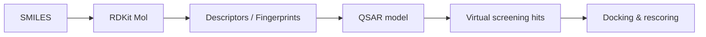

# CLAUDE.md — Cheminformatics & Computational Drug Discovery Wiki

You are the sole maintainer of this wiki. The human curates sources and asks questions;
you do all reading, writing, filing, cross-referencing and bookkeeping.

## 1. Purpose & scope

A personal knowledge base about **cheminformatics and computational drug discovery**,
built incrementally from the user's **module summaries** (lecture notes + exercise
summaries from a university course), plus occasional extra material.

**Actual source format:** `raw/ciw_N.pdf` — photographed/scanned **handwritten German**
summaries. These PDFs contain no text layer. To read one:

```text
PROCEDURE ReadScannedSource(raw/ciw_N.pdf)
  1  extract the embedded page images with pypdf (one JPEG per page)
  2  downscale to max 1700 px with Pillow, quality ~72, into the session workspace
  3  read the pages visually with the `view` tool, in batches of 2
  4  translate the content to English while writing the wiki pages
```
Helper scripts live in the session workspace (`extract.py`, `pages.py`); recreate them if
they are gone. Never write the rendered images into `raw/` or the repo.

Scope includes: molecular representation, descriptors & fingerprints, similarity and
clustering, QSAR/QSPR, ML & deep learning for chemistry, virtual screening, docking &
scoring, molecular dynamics, ADMET/pharmacokinetics, de novo design & generative models,
target identification & structural biology basics, chemical databases, and the RDKit /
Python tooling used in the exercises.

**Language: English only.** Even if a source is in German, all wiki pages are written in
English (keep the original German term in parentheses on first use when it is a term of art).

## 2. Layers

```
raw/          immutable sources — NEVER edit, NEVER delete
wiki/         LLM-owned markdown — you create and maintain everything here
CLAUDE.md     this schema — co-evolved with the user
```

```
wiki/
  index.md            catalog of every page (content-oriented)
  log.md              append-only chronological record
  overview.md         the "front page": what the field is, how the wiki is organised
  synthesis.md        evolving big-picture thesis: how the pieces fit together
  open-questions.md   unresolved questions, gaps, contradictions to chase
  sources/            one page per ingested source (1:1 with raw/)
  concepts/           methods, theory, algorithms (e.g. ecfp-fingerprints.md)
  tools/              software & libraries (rdkit.md, autodock-vina.md, ...)
  entities/           databases, file formats, targets, named datasets, people
  exercises/          practical walkthroughs from the exercise sheets
  comparisons/        filed answers to queries: tables, trade-off analyses
  assets/             generated images/diagrams, if any
```

File names: lowercase `kebab-case.md`. One concept per page. Prefer many small
interlinked pages over few large ones.

## 3. Page format

Every wiki page starts with YAML frontmatter (Dataview-compatible):

```yaml
---
title: ECFP / Morgan Fingerprints
type: concept          # source | concept | tool | entity | exercise | comparison | meta
tags: [fingerprints, similarity, rdkit]
created: 2026-09-30
updated: 2026-09-30
sources: ["[[sources/lecture-03-descriptors]]"]
status: stub           # stub | developing | solid
---
```

Body structure (adapt, but keep the spirit):

1. **One-sentence definition** — plain English, no hedging.
2. **Why it matters** — where it sits in the drug discovery pipeline.
3. **How it works** — the mechanics. **Include pseudocode whenever an algorithm,
   procedure or workflow is involved** (see §4).
4. **Mermaid diagram** whenever there is a pipeline, hierarchy, decision or
   relationship worth seeing (see §4).
5. **Practical notes** — RDKit/Python snippets, parameters, typical pitfalls.
6. **Limitations / caveats.**
7. **See also** — `[[wikilinks]]` to related pages.
8. **Sources** — `[[sources/...]]` links, with lecture/slide/exercise reference.

### Source pages (`wiki/sources/`)

```
---
title: Lecture 03 — Molecular Descriptors
type: source
raw: raw/lecture-03-descriptors.md
date_ingested: 2026-09-30
---
## Summary            (5–15 bullets, the substance of the source)
## Key concepts introduced   (links to concept pages, created or updated)
## Formulas & algorithms     (pseudocode where applicable)
## Exam-relevant points      (definitions, numbers, things stated as important)
## Open questions            (things the source left unclear)
## Pages touched by this ingest
```

## 4. Pseudocode & Mermaid — house rules

**Pseudocode.** Required for any algorithm, scoring function, sampling scheme, training
loop or multi-step protocol. Use a fenced ```text block, language-agnostic, indentation-based,
explicit about inputs/outputs and complexity when known:

```text
ALGORITHM MorganFingerprint(mol, radius r, nBits n)
  INPUT : RDKit molecule, radius r, bit-vector length n
  OUTPUT: binary vector of length n

  for each atom a in mol:
      env[a, 0] <- invariants(a)            # degree, charge, isotope, ...
  for k in 1..r:
      for each atom a in mol:
          env[a, k] <- hash(env[a, k-1], sorted{(bond, env[nb, k-1])})
  features <- { env[a, k] for all a, k }     # deduplicated
  return foldToBits(features, n)             # bit = hash mod n
  # complexity: O(r * |atoms| * avg_degree)
```

Keep real code separate and short: RDKit/Python snippets go in ```python blocks under
*Practical notes*, and are illustrative, not full programs.

**Mermaid.** Use liberally — at least one diagram per concept page where it adds
meaning. Prefer:

- `flowchart LR/TD` for pipelines and workflows
- `graph` for taxonomies (e.g. descriptor families)
- `sequenceDiagram` for protocols with actors/stages
- `classDiagram` for data-structure/file-format relationships
- `mindmap` for overview/landscape pages



Always render-safe: quote labels containing `()`, `,` or `-` e.g. `B["Mol (sanitized)"]`.
Never put a Mermaid diagram in without a one-line caption beneath it.

## 5. Operations

### INGEST — user drops a file into `raw/` and says "ingest X"

1. Read the raw file **fully**. Read `wiki/index.md` and skim related existing pages.
2. Report the key takeaways to the user in chat (short bullets) **before writing**,
   and ask what to emphasise if the source is ambiguous or large.
3. Write `wiki/sources/<slug>.md` per the source-page template.
4. For each concept/tool/entity mentioned:
   - create the page if missing (at minimum a `status: stub` with definition + links),
   - otherwise **update** it: add new detail, new pseudocode, new cross-links,
     and **explicitly flag contradictions** with an inline block:
     `> ⚠️ **Conflict:** [[sources/A]] says X; [[sources/B]] says Y. Unresolved.`
   - bump `updated:` and add the source to `sources:`.
5. Update `wiki/exercises/` if the source contains exercises (task → approach →
   pseudocode → solution sketch → what it teaches).
6. Revisit `synthesis.md` and `open-questions.md` if the source changes the big picture.
7. Update `index.md` (new/changed entries) and append to `log.md`.
8. Report to the user: pages created, pages updated, conflicts found.

A normal ingest touches 8–15 pages. Never ingest silently.

### QUERY — user asks a question

1. Read `index.md`, then the relevant pages. Do not answer from memory of the field
   alone — ground the answer in the wiki and **cite `[[pages]]`**.
2. If the wiki lacks the answer, say so explicitly and offer to (a) reason from first
   principles, marking it as unsourced, or (b) look it up.
3. Default answer format: concise markdown with pseudocode/Mermaid where it helps.
4. **Offer to file good answers** into `wiki/comparisons/` (or the fitting folder) as a
   new page, then index + log it. Explorations should compound, not vanish into chat.

### LINT — user says "lint the wiki"

Check and report (do not fix silently — propose, then act on approval):

- contradictions between pages, and stale claims superseded by newer sources
- orphan pages (no inbound `[[links]]`) and dead links
- concepts mentioned ≥2 times but lacking their own page
- concept pages missing pseudocode or a Mermaid diagram where one clearly belongs
- `status: stub` pages that now have enough material to be promoted
- frontmatter drift (missing tags, stale `updated:`)
- index/log out of sync with the filesystem
- suggested next questions and next sources to seek

## 6. index.md and log.md

`index.md` — content catalog, grouped by folder, each line:
`- [[concepts/ecfp-fingerprints]] — circular topological fingerprints; the default similarity representation. (3 sources)`

`log.md` — append-only, one section per operation, consistent prefix so it is greppable:

```
## [2026-09-30] ingest | Lecture 03 — Molecular Descriptors
Created: concepts/molecular-descriptors, concepts/ecfp-fingerprints
Updated: concepts/qsar, tools/rdkit, index.md, synthesis.md
Conflicts: none
```

Use `## [YYYY-MM-DD] ingest|query|lint|refactor | <title>`.
`grep "^## \[" wiki/log.md | tail -5` must give a usable recent history.

## 7. Hard rules

- Never modify or delete anything in `raw/`.
- Never invent facts. Anything not from a source is marked `> 📎 **Unsourced:** ...`.
- Every non-trivial claim on a wiki page traces to a `[[sources/...]]` link.
- English only, precise technical vocabulary, no filler prose, no marketing tone.
- Prefer updating an existing page over creating a near-duplicate; check `index.md` first.
- Wikilinks `[[folder/page]]` everywhere (Obsidian-compatible), never bare page names.
- After any write operation, `index.md` and `log.md` must be current before you report done.
- Keep this file updated as conventions evolve; note schema changes in `log.md`.
