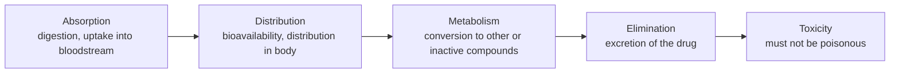

# ADMET and the Six Boundary Conditions

**ADMET** = Absorption, Distribution, Metabolism, Elimination, Toxicity — the set of
pharmacokinetic and safety properties a compound must satisfy in addition to binding its target.

## Why it matters

A molecule can bind its target perfectly and still fail as a drug. Most late-stage attrition
is ADMET, not potency, which is why ADMET prediction is a core cheminformatics task
([[concepts/drug-discovery-pipeline]]).

## The six boundary conditions (Randbedingungen)

The lecture derives ADMET from six conditions the active ingredient must fulfil:

| # | Boundary condition | ADMET letter |
|---|---|---|
| 1 | The drug must be suitable for the intended dosage form (Darreichungsform) | D — distribution |
| 2 | Bioavailability — the fraction of the applied drug that becomes systemically available | A — absorption |
| 3 | Specificity of the drug | M — metabolism |
| 4 | Non-toxicity of the drug | T — toxicity |
| 5 | Elimination of the drug | E — elimination |
| 6 | Synthetic accessibility (Synthetisierbarkeit) of the drug | — (not ADMET) |

> 📎 **Note:** the handwritten mapping in the source numbers the conditions 2-1-3-5-4 above
> A-D-M-E-T respectively; the table follows that ordering.

## The ADMET chain

*The ADMET chain: each stage can kill a candidate independently of its target affinity.*

## Constraints along the route

- **Stomach** — the drug must not be attacked by the acidic environment.
- **Intestine** — the drug must be resorbed through the intestinal wall.
- **Transport** — local (near the site of action) or systemic (via the bloodstream).
- **Liver** — the drug must not be chemically altered or eliminated prematurely.
- **Brain** — the drug must leave the blood vessels and penetrate into the brain
  (blood–brain barrier).

**Routes of administration**: oral, parenteral, rectal, vaginal, inhalational, cutaneous.
The dosage form influences distribution.

## Biotransformation and elimination

- **Biotransformation** — chemical conversion of the active ingredient in the organism,
  mainly in **liver** and **kidney**.
- Consequences: loss of efficacy, but also gain in water solubility (which enables excretion).

## Points of attack in the organism

- cellular transport systems
- neural control
- hormonal control
- direct influence on metabolism (enzymes) → [[concepts/enzymes-and-receptors]]

## See also

- [[concepts/pharmacokinetics-and-pharmacodynamics]]
- [[concepts/drug-discovery-pipeline]]

## Sources

- [[sources/ciw-01-drug-action-and-molecular-interactions]] (pp. 3–4)
