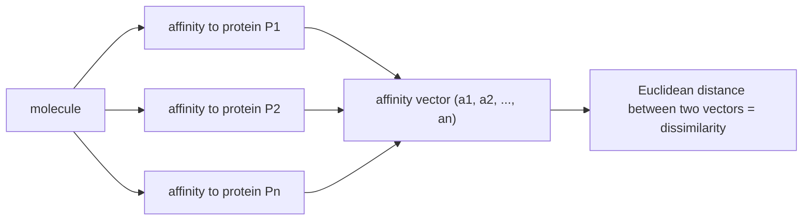

# Affinity Fingerprints

A descriptor that abandons structure altogether: describe a molecule by the **vector of its
binding affinities to a reference panel of proteins**.

## Idea

> Molecules with **similar binding behaviour towards a reference set of proteins are
> similar.**

This inverts the usual logic of cheminformatics. Everywhere else the chain runs
*structure → descriptor → predicted behaviour*; here the behaviour **is** the descriptor.

## Definition

```text
descriptor : the binding affinities of a molecule to a protein panel P₁, …
             ( a₁, a₂, … )

distance   : Euclidean distance between affinity vectors
```


*The panel acts as a set of probes; the response profile is the fingerprint.*

## Variants

| Variant | Mechanism |
|---|---|
| **"In-silico" affinity fingerprints** | instead of measuring, the affinity is **predicted with a docking program** |
| **SEA approach** | target identification via the molecular similarity of ligands |

The in-silico variant exists purely to escape the central weakness:

⚠️ **Problem: the descriptor must be determined experimentally.**

Every new molecule requires a full panel of assays before it has a descriptor at all, which
rules the method out for virtual libraries — the very case where
[[concepts/virtual-screening]] is most useful.

## See also

- [[concepts/autocorrelation-vectors]]
- [[concepts/virtual-screening]]
- [[concepts/high-throughput-screening]]
- [[concepts/enzymes-and-receptors]]

## Sources

- [[sources/ciw-04-descriptor-evaluation-clustering-and-superposition]] (p. 7)
