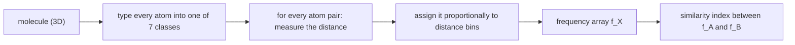

# Atom-Pair and Atom-Triplet Descriptors

Geometric descriptors that encode a molecule as a **histogram of binned distances between
typed atoms** — the practical way to capture a [[concepts/pharmacophore]] without solving
the conformation problem exactly.

## Atom-pair descriptor

```text
7 atom classes, defined by their bonding capability
   e.g. strong acceptor > weak acceptor > N > weak donor > strong donor

array f_X stores the frequencies of occurring
        [ class(i) − distance − class(j) ]
   units between atoms i, j in molecule X

distances are discretised by defining intervals (bins) of increasing size
atom pairs are assigned proportionally to several bins
```

Two design choices worth noting:

- **Bins of increasing size.** Short distances are measured precisely, long ones coarsely —
  because conformational uncertainty grows with distance.
- **Proportional (fuzzy) assignment to several bins.** A pair falling near a bin boundary
  contributes to both, which stops a small coordinate change from flipping the descriptor.


*Type, measure, bin, count — the descriptor is just a histogram over (class, class, distance) triples.*

## Similarity index

```text
              Σ_{k ∈ bins} min( f_A[k], f_B[k] )
sim(A,B) = ──────────────────────────────────────────
            ½ · Σ_{k ∈ bins} ( f_A[k] + f_B[k] )
```

This is the same count-overlap form used for feature-tree labels
([[concepts/feature-trees]]) — a soft, graded intersection over a count vector.

## Atom-triplet descriptor

Instead of pairs, **atom/PPP triplets** are used. The index is then

- a **sorted list of the triangle edges**, and
- for the histogram: **perimeter, centre, area** of the triangle.

Triplets fix the *chirality-blindness* of pairs: three points define a plane and an
orientation, so a triplet descriptor can distinguish mirror-image arrangements that a pair
descriptor cannot.

## Handling the conformation problem

| Approach | Mechanism |
|---|---|
| Database with several conformations per molecule | generate a conformational ensemble first ([[concepts/conformation-generation]]) |
| Descriptor merges the entries for the different conformations | *fusion* — one descriptor that covers all accessible geometries |

## Verdict from the lecture

> **3D often performs worse than topological!**
>
> - We do not know the conformations ⇒ **noise** (which pairs are really at this distance?)
> - **Bias in the data** towards topologically similar molecules

A more accurate description of molecular similarity requires **structural superposition**
([[concepts/molecular-superposition]]) — which is the subject of the next chapter.

## See also

- [[concepts/pharmacophore]]
- [[concepts/ultrafast-shape-recognition]]
- [[concepts/conformation-generation]]
- [[concepts/molecular-superposition]]
- [[concepts/reduced-graphs]]

## Sources

- [[sources/ciw-04-descriptor-evaluation-clustering-and-superposition]] (pp. 4–5)
