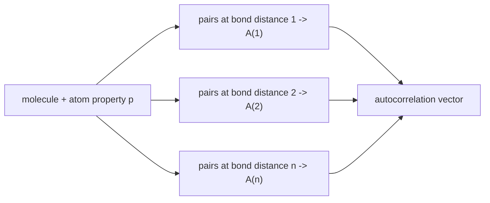

# Autocorrelation Vectors

A descriptor built from the **spatial autocorrelation** of atom properties: the probability
that a property recurs in the neighbourhood.

## Definition

**Spatial autocorrelation** describes the probability that a property occurs again in the
neighbourhood. Applied to molecular structures:

```text
A(d) = Σ_{ij} d_ij · p_i · p_j

  d_ij = 1  if the bond distance between atoms i and j is d,  else 0
  p_i  = atom property of atom i

autocorrelation vector = ( A(1), A(2), …, A(n) )
```

Component `A(d)` sums the products of the property values over all atom pairs exactly `d`
bonds apart.


*One vector component per bond distance; each is a property-weighted pair count.*

## Idea

> Similar molecules have **similar neighbourhood relations between the properties that are
> relevant for binding.**

Note that the distance here is a **bond distance**, not a spatial one — the descriptor is
topological, which is exactly why it tends to outperform the 3D descriptors of
[[concepts/atom-pair-and-triplet-descriptors]]: it needs no conformation.

## Caveats

- Summing over all pairs at a given distance loses the information of *which* pairs; two
  different molecules can share an autocorrelation vector.
- The choice of atom property `p` (partial charge, polarisability, H-bond capability)
  determines what the descriptor is sensitive to.

## See also

- [[concepts/affinity-fingerprints]]
- [[concepts/atom-pair-and-triplet-descriptors]]
- [[concepts/reduced-graphs]]
- [[concepts/clustering-of-molecules]]

## Sources

- [[sources/ciw-04-descriptor-evaluation-clustering-and-superposition]] (p. 7)
