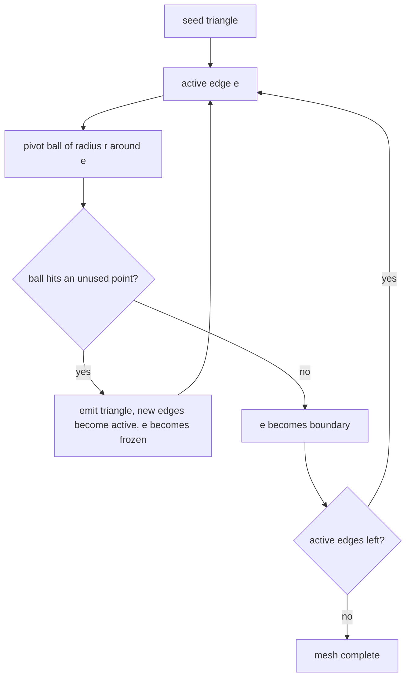

# Ball-Pivoting Algorithm (BPA)

A surface-reconstruction method that generates **triangle meshes from unorganised point
cloud data** by iteratively pivoting a ball of fixed radius around the points.

## Mechanism

The algorithm identifies neighbouring points within the ball and forms triangles, gradually
expanding the mesh. It belongs to the same family of interpolation techniques as the
probe-sphere constructions of [[concepts/molecular-surfaces]] — rolling a ball around the
molecule — but its output is a **triangulation / mesh-generation** result rather than an
analytic patch decomposition.

```text
ALGORITHM BallPivoting(points P, radius r)
  seed: find a triangle whose circumscribed ball of radius r contains no other point
  mark its edges active
  while an active edge e exists:
      pivot a ball of radius r around e
      if it hits an unused point q:
          emit triangle (e, q); mark new edges active; mark e frozen
      else:
          mark e boundary
```


*The ball rolls from edge to edge; each successful pivot adds one triangle and two candidate edges.*

## Radius of the ball

| Radius | Effect |
|---|---|
| **smaller** | smaller result, **more accurate**, higher level of detail |
| **too small** | overly **sensitive to noise** |
| larger | coarser mesh, holes bridged over |

The radius is therefore a detail-versus-robustness dial, exactly analogous to the probe
radius in the molecular-surface definitions.

## Edge labels

| Label | Meaning |
|---|---|
| **active** | initially all edges; candidates for forming triangles |
| **boundary** | forms part of the boundary of the reconstructed surface mesh |
| **frozen** | an edge that has been used to form triangles and has no unprocessed points left in its adjacent region |

**Transition active → boundary:** when an adjacent point has no neighbouring points within
the point cloud at radius `r`.

## See also

- [[concepts/molecular-surfaces]]
- [[concepts/marching-cubes]]
- [[concepts/connolly-surface-algorithm]]
- [[exercises/ciw-e4-moss-and-surfaces]]

## Sources

- [[sources/ciw-03-pattern-mining-diagrams-surfaces-and-reduced-graphs]] (p. 19)
