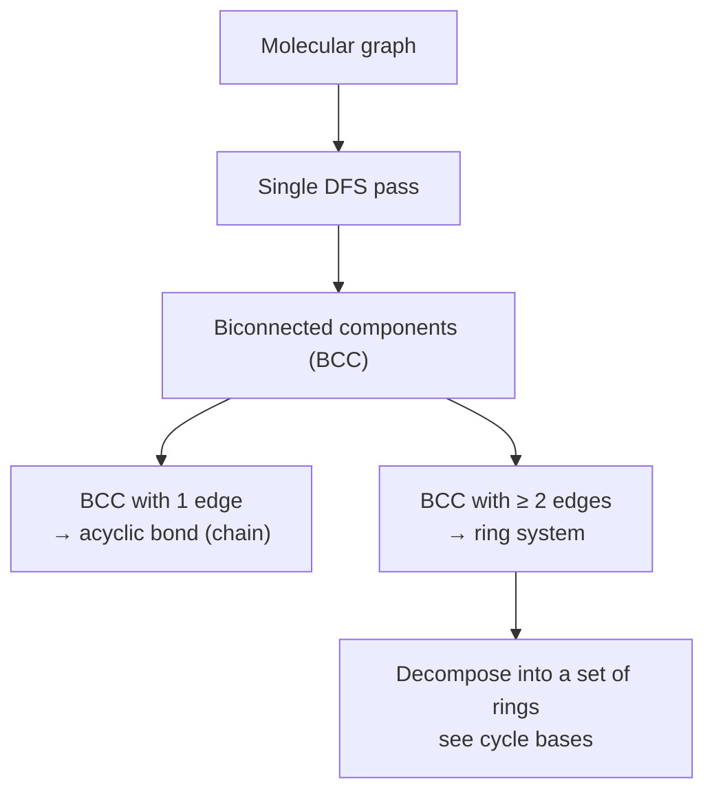

# Biconnected Components and Acyclic Bonds

The first step of [[concepts/ring-perception]]: split a molecule into **ring bonds** and
**chain bonds**.

## Acyclic bond

> A bond is **acyclic** if the molecular graph is no longer connected after removing the bond.

### Naive test

```text
ALGORITHM test-cyclic(e = (x,y), V, E)
  INPUT : bond e, node set V, edge set E
  OUTPUT: "cyclic" or "acyclic"

  E' <- E \ {e}
  for each v ∈ V: visited[v] <- false
  dfs(x, V, E', visited)
  if visited[y]: return "cyclic"      # y still reachable without e
  else:          return "acyclic"

PROCEDURE dfs(v, E, visited)
  visited[v] <- true
  for each w ∈ Adj[v]:
      if not visited[w]: dfs(w, E, visited)
```

Cost: **O(|V| + |E|)** per test ⇒ **O(|E|·(|V| + |E|))** for all bonds.

### Improvement

> Computing the **biconnected components** — a single DFS pass is sufficient: **O(|V| + |E|)**.

GCI part 3 spells out the low-link version of this improvement: discovery times `d[v]` and low-link values `low[v]` identify tree edges that have no back-edge escape route.

```text
ALGORITHM TarjanCyclicAndAcyclicBonds(G)
  INPUT : molecular graph G = (V,E)
  OUTPUT: cyclic[e] for each bond e, articulation atoms

  for each atom u: d[u] <- 0; low[u] <- 0
  for each bond e: cyclic[e] <- true
  time <- 0
  for each atom u:
      if d[u] == 0: DFSVisit(u, parent = none)

PROCEDURE DFSVisit(u, parent)
  time <- time + 1; d[u] <- time; low[u] <- d[u]
  childCount <- 0
  for each neighbour v of u:
      if d[v] == 0:
          childCount <- childCount + 1
          DFSVisit(v, u)
          low[u] <- min(low[u], low[v])
          if low[v] > d[u]: cyclic[(u,v)] <- false
          if parent != none and low[v] >= d[u]: mark u as articulation
      else if v != parent:
          low[u] <- min(low[u], d[v])
  if parent == none and childCount >= 2: mark u as articulation
  # complexity: O(|V| + |E|)
```

Source: [[sources/gci-03-stereochemistry-rings-substructure-and-mcs]] (pp. 12-16).

## Biconnectivity in undirected graphs

- A node `v` is an **articulation node** (Gelenkknoten) if removing `v` destroys connectivity.
- Two edges are **biconnected** if there exists a simple cycle containing both.
- Biconnectivity is an **equivalence relation on the set of edges**; the equivalence classes
  are called **biconnected components (BCC)**.
- BCCs can be determined via DFS.
- **BCCs with only one bond → acyclic bond.**
- A DFS-tree edge `(u,v)` is acyclic when `low[v] > d[u]`.
- A non-root atom is an articulation node when it has a child `v` with `low[v] >= d[u]`; a DFS root is an articulation node only if it has at least two DFS-tree children.


*One DFS gives the ring/chain decomposition; each multi-edge BCC is a ring system to be analysed further.*

## Decomposition into ring and chain bonds

```text
GIVEN : molecular graph (cyclic and acyclic parts)
ASKED : decomposition into ring bonds and chain bonds
```

Each biconnected component with more than one edge is a **ring system**, which is then
passed to ring-basis computation ([[concepts/cycle-space-and-cycle-basis]]).

The same cyclic/acyclic labels support [[concepts/rotatable-bonds]]: the GCI rule treats non-ring single bonds between non-terminal atoms as rotatable torsions.

## See also

- [[concepts/ring-perception]]
- [[concepts/linkers-and-chains]]
- [[concepts/cycle-space-and-cycle-basis]]
- [[concepts/rotatable-bonds]]

## Sources

- [[sources/ciw-02-substructure-search-and-ring-perception]] (p. 9)
- [[sources/gci-03-stereochemistry-rings-substructure-and-mcs]] (pp. 11-16)
