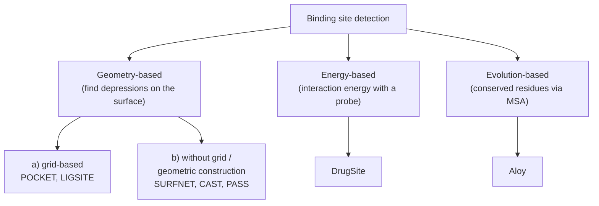

# Binding site detection

The automated determination of active sites: given only the 3D structure of a protein,
predict the regions where small molecules can bind.

## Definitions

- **Binding pocket (binding site)** — the part of the protein at which the binding of
  ligands can occur.
- **Active site** — the binding pocket of an *enzyme*, i.e. one with catalytic function.

Shape and energetic properties of the active site determine the binding partner and
therefore the **function** of the protein.

## Problem statement

```text
PROBLEM  Detection of active sites
INPUT  : 3D structure of a protein
OUTPUT : binding regions for small molecules, i.e. the active sites

APPLICATIONS
  - protein–ligand docking          (where to dock)
  - functional characterisation     (what does this protein do)
  - druggability analysis           (is it worth targeting)
```

Every docking method in [[concepts/docking]] silently assumes the answer to this problem is
already known. In genuine structure-based discovery — a newly solved structure, no known
ligand — it is not.

## Method families


*Three questions about the same surface: is it concave, is it attractive, is it conserved?*

| Family | Question asked | Representatives |
|---|---|---|
| geometry-based, grid | is this grid point buried? | [[concepts/ligsite-and-pocket]] |
| geometry-based, spheres/Voronoi | does a sphere fit in the gap? | [[concepts/surfnet]], [[concepts/cast-alpha-shapes]], [[concepts/pass-algorithm]] |
| energy-based | does a probe feel attraction here? | [[concepts/drugsite]] |
| evolution-based | is this residue conserved? | [[concepts/evolutionary-site-prediction]] |

## Problems with the prediction

```text
GEOMETRY-BASED / GRID-BASED
    sensitive to: grid width, position and orientation of the protein in the grid
    plus the definition of the pocket LID

WITHOUT GRID / GEOMETRIC CONSTRUCTION
    spheres : problems delimiting WIDE pockets ⇒ volume overestimated
    Voronoi : finds only pockets whose opening is SMALLER than
              every cross-section through the pocket

ENERGY-BASED
    depends on the scoring function and the force-field parameterisation

EVOLUTION-BASED
    depends on the number of known related sequences

⇒ LARGE VARIABILITY OF ACTIVE SITES
    from a small pocket to a large pocket with 4 subsites
```

The last line is the real obstacle: there is no single geometric signature of "binding
site", because active sites range from a shallow groove to a four-subsite cavern. Any method
tuned to one extreme fails at the other.

## Caveats

- Predicted pockets must be validated — see
  [[concepts/binding-site-prediction-evaluation]].
- Several pockets are usually predicted per protein; deciding which is *the* binding site is
  a separate problem.
- Grid-based methods are not rotation-invariant, which is an artefact, not chemistry.

## See also

- [[concepts/druggability]]
- [[concepts/docking]]
- [[concepts/molecular-surfaces]]
- [[concepts/enzymes-and-receptors]]
- [[concepts/protein-flexibility]]

## Sources

- [[sources/ciw-06-flexible-docking-binding-sites-and-fragment-spaces]] (pp. 8, 12)
