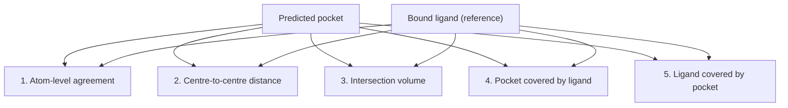

# Binding site prediction evaluation

How to judge whether a [[concepts/binding-site-detection|binding-site prediction method]] is
any good — five criteria, plus two uncomfortable questions about the benchmark itself.

## Why it matters

"Did it find the site?" has no single answer, because a prediction is a *region* and the
reference is a *ligand*, and the two can agree in several incompatible ways: same centre but
wrong size, right size but offset, or engulfing the ligand entirely. The accuracy figures
quoted for [[concepts/cast-alpha-shapes]] (74 %), [[concepts/pass-algorithm]] (63 %) and
[[concepts/drugsite]] (8 %) are only comparable if the criterion is fixed.

## The five criteria

```text
CRITERIA FOR THE QUALITY OF A METHOD

1. agreement of the predicted interaction atoms with the
   actually occupied atoms
2. DISTANCE: centre of the predicted binding pocket
   to the centre of the ligand
3. COMPARISON: intersection between the predicted binding pocket
   and the position of the ligand
4. COVERAGE of the predicted binding pocket by the ligand
5. COVERAGE of the ligand by the predicted binding pocket
```


*Criteria 4 and 5 are deliberately asymmetric: a huge pocket can cover the ligand perfectly while being almost entirely empty.*

Criteria 4 and 5 are the precision/recall pair of this problem:

| | Meaning | Punishes |
|---|---|---|
| 4. pocket covered by ligand | how much of my prediction is real | over-large predictions |
| 5. ligand covered by pocket | how much of the truth I found | under-sized predictions |

Reporting only one of them is the standard way to flatter a method — exactly the
over-optimism trap already seen in [[concepts/qsar-model-validation]].

## Two open questions about the benchmark

```text
→ WHICH predicted binding pockets are used in the evaluation?
     (top 1? top 3? all of them?)
→ WHICH is the CORRECT binding pocket?
     (a protein may have several genuine sites;
      the crystallised ligand marks only one)
```

The "(1)" and "(3)" annotations next to the accuracy percentages refer to the first
question: whether the true site had to be the top-ranked prediction or merely among the top
three. A method's number can nearly double by relaxing this.

## Caveats

- The reference is a single crystallised ligand, which is evidence that a site binds *that*
  ligand, not that no other site exists.
- Apo versus holo structures differ; evaluating on holo structures leaks the answer, since
  the pocket is already open.

## See also

- [[concepts/binding-site-detection]]
- [[concepts/roc-curves-and-auc]]
- [[concepts/enrichment-factor]]
- [[concepts/qsar-model-validation]]
- [[concepts/druggability]]

## Sources

- [[sources/ciw-06-flexible-docking-binding-sites-and-fragment-spaces]] (p. 13)
