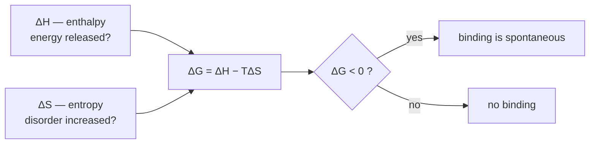

# Binding Thermodynamics (Kᵢ, ΔG, IC₅₀)

The quantitative description of how strongly a ligand binds, and what drives that binding.

## Core quantities

**Binding / dissociation constant Kᵢ** — the fraction of ligands that is on average bound to
the protein. The **smaller, the stronger** the binding. Unit: mol/L.

```text
Kᵢ = [Ligand] · [Protein] / [Ligand · Protein]
```

**Free binding enthalpy (Gibbs free energy)**

```text
ΔG = R · T · ln Kᵢ           [kJ/mol]      R = gas constant, T = absolute temperature
Kᵢ = e^(ΔG / RT)             (rearranged)
ΔG < 0  ⇒  the reaction proceeds spontaneously
```

**IC₅₀** — the ligand concentration at which the protein activity drops to 50 %.

## Reference values

| Quantity | Very good inhibitor |
|---|---|
| Kᵢ | 10⁻⁹ M = 1 nM |
| ΔG | ≈ −53.4 kJ/mol |

## Decomposition into enthalpy and entropy

```text
ΔH = ΔU − volume work        # enthalpy; bio/chemical processes run at constant pressure
ΔS                           # entropy: degree of disorder of a system
ΔG = ΔH − T · ΔS             # free enthalpy
```

| Term | Question it answers | Favourable when |
|---|---|---|
| ΔH (enthalpy) | Does the process release energy? | ΔH negative |
| ΔS (entropy) | Does disorder increase? | ΔS large / positive |
| ΔG (free enthalpy) | Is the process spontaneous? | ΔG negative |


*Affinity is the balance of an enthalpic and an entropic term, not a single number.*

## Computing affinity from a calorimetry measurement

```text
ALGORITHM AffinityFromITC(ΔH, ΔS, T)
  INPUT : ΔH [kcal/mol], ΔS [cal/(K·mol)], T [K]
  OUTPUT: ΔG [kJ/mol] and Kᵢ [mol/L]

  ΔG_kcal <- ΔH − T · (ΔS / 1000)        # ΔS given in cal, convert to kcal
  ΔG      <- ΔG_kcal · 4.1868            # kcal/mol -> kJ/mol
  Kᵢ      <- exp(ΔG / (R · T))           # R = 8.314e-3 kJ/(K·mol)
  return ΔG, Kᵢ
```

Worked example from the exercise sheet
([[exercises/ciw-e1-thermodynamics-and-hydrogen-bonds]]):
ΔH = −8.87 kcal/mol, ΔS = 2.83 cal·K⁻¹·mol⁻¹, T = 300 K →
ΔG = −9.731 kcal/mol = −40.74 kJ/mol.

## Entropic contributions to binding

- highly ordered = low entropy; disordered = high entropy
- contributions arise from:
  - fixing the relative orientation of the ligand to the protein → **loss**
  - fixing the ligand conformation → **loss**
  - release of previously bound water molecules (buried surface, desolvation) → **gain**
- **Entropic compensation**: the number of freed water molecules scales with the size of the
  hydrophobic surface; new degrees of freedom offset lost degrees of freedom.
- **Desolvation is the main entropic contribution**, proportional to the hydrophobic surface.

## GCI affinity recap

GCI part 4 repeats the operational affinity quantities in the descriptor context: `K_i = [ligand][protein]/[ligand-protein]`, smaller `K_i` means stronger binding, `?G = RT ln K_i`, and `IC50` is the concentration at which protein activity is reduced by 50 %.

## See also

- [[concepts/enthalpy-entropy-compensation]]
- [[concepts/desolvation-and-water]]
- [[concepts/protein-ligand-binding]]
- [[exercises/ciw-e1-thermodynamics-and-hydrogen-bonds]]

## Sources

- [[sources/ciw-01-drug-action-and-molecular-interactions]] (pp. 10, 14, 21)
- [[sources/gci-04-molecular-glues-descriptors-fingerprints-and-similarity]] (p. 1)
