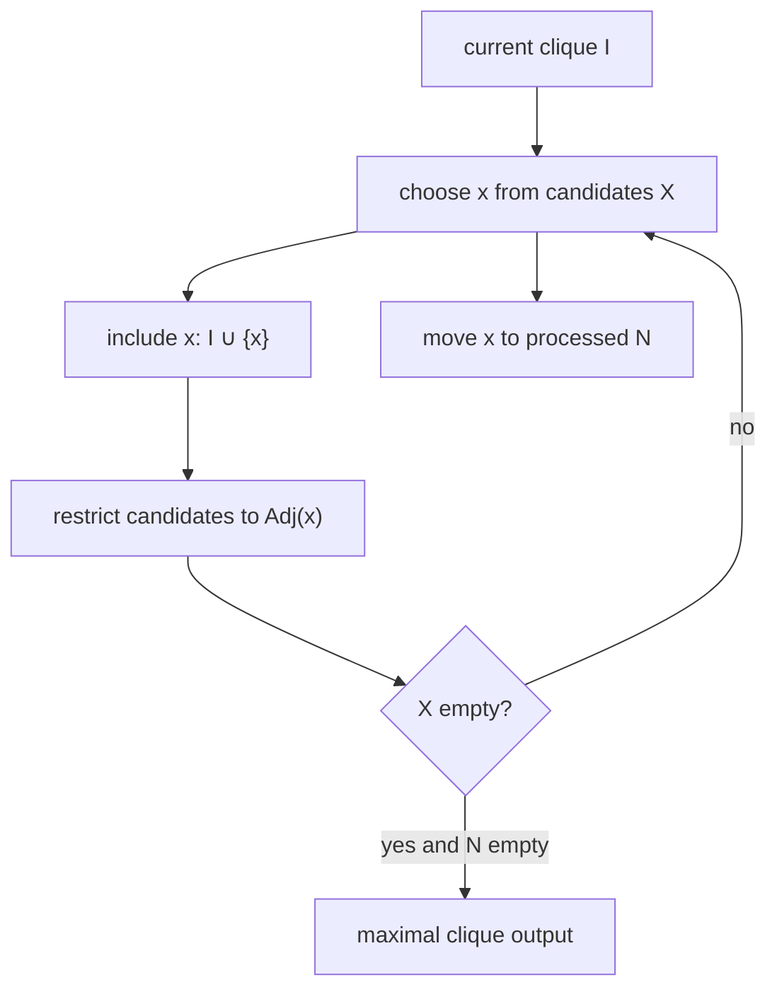

# Bron-Kerbosch Algorithm

The Bron-Kerbosch algorithm enumerates maximal cliques by recursively maintaining a current clique, expandable candidates and already-processed forbidden vertices.

## Why it matters

GCI part 3 uses Bron-Kerbosch as the clique engine behind [[concepts/maximum-common-substructure]] after building a [[concepts/modular-product-graph]]. It is also the same clique-search pattern seen in docking and pharmacophore algorithms elsewhere in the wiki.

## How it works

The notes use three sets:

| Set | Meaning |
|---|---|
| `I` / `compsub` | current clique in the recursion |
| `X` / `candidates` | vertices that can still extend the clique |
| `N` / `not` | vertices already considered; adding them would duplicate a clique already found |

```text
ALGORITHM BronKerbosch(G, I, X, N)
  INPUT : graph G, current clique I, candidate set X, processed set N
  OUTPUT: all maximal cliques exactly once

  if X == empty:
      if N == empty: output I
      return
  if exists n in N such that X subset Adj(n):
      return                         # every extension would duplicate a previous branch
  for each x in copy(X):
      BronKerbosch(G, I ∪ {x}, X ∩ Adj(x), N ∩ Adj(x))
      X <- X \ {x}
      N <- N ∪ {x}
```

```text
ALGORITHM BranchAndBoundClique(G, I, X, N, best)
  INPUT : graph G, current clique I, candidates X, processed N, current best clique
  OUTPUT: updated largest clique found

  if |I| + |X| < |best|: return best
  if X == empty:
      if N == empty and |I| > |best|: best <- I
      return best
  for each x in copy(X):
      best <- BranchAndBoundClique(G, I ∪ {x}, X ∩ Adj(x), N ∩ Adj(x), best)
      X <- X \ {x}; N <- N ∪ {x}
  return best
```

```text
ALGORITHM CConnectedBronKerbosch(P, I, X, C, N)
  INPUT : product graph P, current clique I, all candidates X, c-connected candidates C, processed set N
  OUTPUT: c-connected maximal cliques for connected MCS

  if X ∩ C == empty:
      if N ∩ C == empty: output I
      return
  if exists n in N ∩ C such that X subset Adj(n): return
  for each x in copy(X ∩ C):
      if I is empty:
          CConnectedBronKerbosch(P, {x}, Adj(x), Adj_c(x), N ∩ Adj(x))
      else:
          CConnectedBronKerbosch(P, I ∪ {x}, X ∩ Adj(x), C ∩ Adj_c(x), N ∩ Adj(x))
      X <- X \ {x}; N <- N ∪ {x}
```


*Bron-Kerbosch branches by including a candidate and then forbidding it for later duplicate-free enumeration.*

## Practical notes

- The branch-and-bound upper bound in the notes is `|I| + |X|`: if even adding all candidates cannot beat the best clique, prune.
- In connected MCS, `C` contains candidates connected to the current clique by c-edges, so growth preserves connectedness.

## Limitations / caveats

- Maximum clique is NP-hard; Bron-Kerbosch is exponential in the worst case.
- Performance depends heavily on pivoting, candidate ordering and compatibility graph size.

## See also

- [[concepts/maximum-common-substructure]]
- [[concepts/modular-product-graph]]
- [[concepts/kuhl-algorithm]]
- [[concepts/disco-algorithm]]

## Sources

- [[sources/gci-03-stereochemistry-rings-substructure-and-mcs]] (pp. 29-34)
