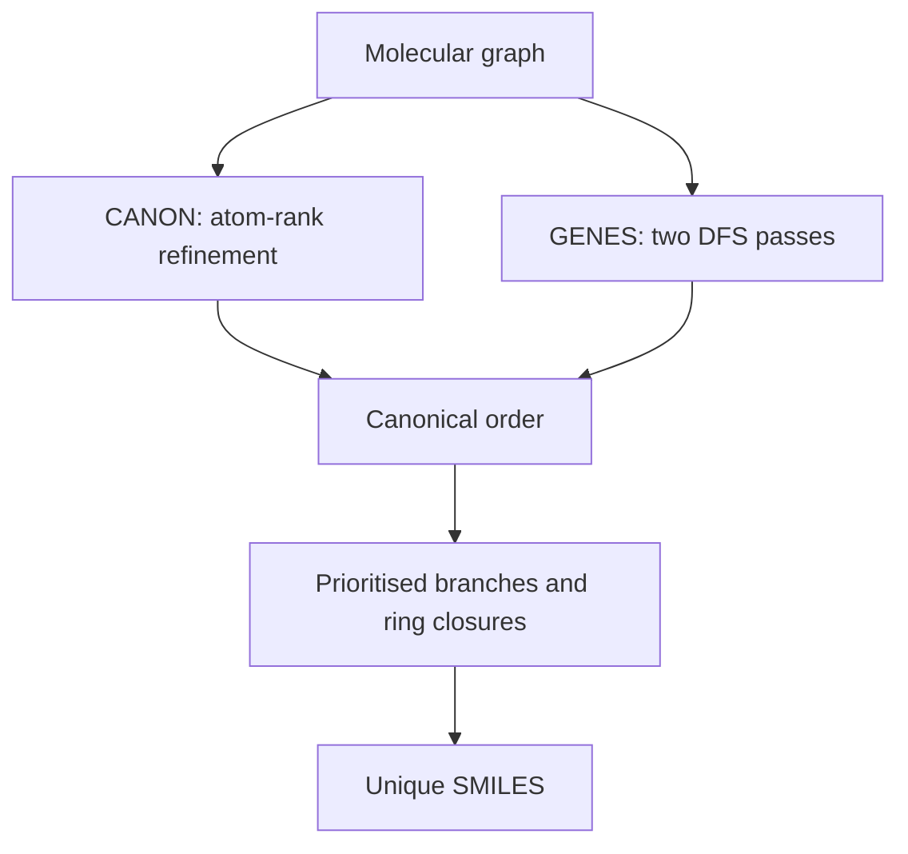

# CANON and GENES Algorithms for Unique SMILES

CANON and GENES are algorithms for producing a unique SMILES by deriving a canonical atom and bond traversal order before printing the string.

## Why it matters

Ordinary [[concepts/smiles-generation]] produces a valid string, but not a database identifier, because multiple start atoms, branches and ring-number choices can encode the same molecule.

## How it works

The source describes two routes. CANON refines atom ranks from extended-sum invariants and resolves ties. GENES starts with two DFS passes, builds an ordering number per atom, uses bond priorities and then prints the unique SMILES from the final order.

```text
ALGORITHM CANONUniqueSMILES(G)
  INPUT : molecular graph
  OUTPUT: canonical SMILES

  ranks <- initial extended-sum atom invariants
  ranks <- refine ranks by neighbour-rank products until stable
  while ranks contain ties:
      for each possible split of the first tied class:
          trialRanks <- refine after the split
          trialOrder <- traversal induced by trialRanks
      ranks <- ranks belonging to the minimal trialOrder
  return GenerateSMILESFromOrder(G, ranks)
```

```text
ALGORITHM GENESUniqueSMILES(G)
  INPUT : molecular graph
  OUTPUT: canonical SMILES

  order1 <- DFS(G) using initial atom-order rules
  order2 <- DFS(G) using order1-derived priorities
  for each atom v:
      orderingNumber[v] <- value from order2 and atom/bond priorities
  bondPriority <- triple bonds before double bonds before single bonds
  break ties by the smallest ordering number
  generate the initial ring sequence and branch order from the priorities
  print atoms, branches and ring closures from the final order
```

```text
PROCEDURE GenerateSMILESFromOrder(G, order)
  INPUT : molecular graph and canonical atom order
  OUTPUT: unique SMILES

  start <- first atom in order
  traverse neighbours sorted by order and bond priority
  when a ring edge is first encountered, assign the next ring number
  when the other side is encountered, print the same ring number
  use parentheses for all but the continuation branch
  return printed string
```


*Unique SMILES generation separates canonical ordering from the final syntax-emission step.*

## Practical notes

- The notes list GENES bond priority as triple greater than double greater than single bond.
- The handwritten exercise warns that ring closures must be treated carefully during recursion/backtracking.
- The result is intended to be unique within one algorithm, not necessarily identical between different software packages.

## Limitations / caveats

- The exercise tables contain many intermediate ranking products; this page records the algorithmic rule rather than every traced number.
- Stereochemistry requires a consistent neighbour order; otherwise a canonical graph string can still misrepresent chirality.

## See also

- [[concepts/molecular-canonicalization]]
- [[concepts/morgan-canonicalization]]
- [[concepts/smiles]]
- [[exercises/gci-e2-identifiers-canonicalization-and-smarts]]

## Sources

- [[sources/gci-02-inchi-canonical-smiles-and-smarts]] (pp. 14-16, 24-29)
