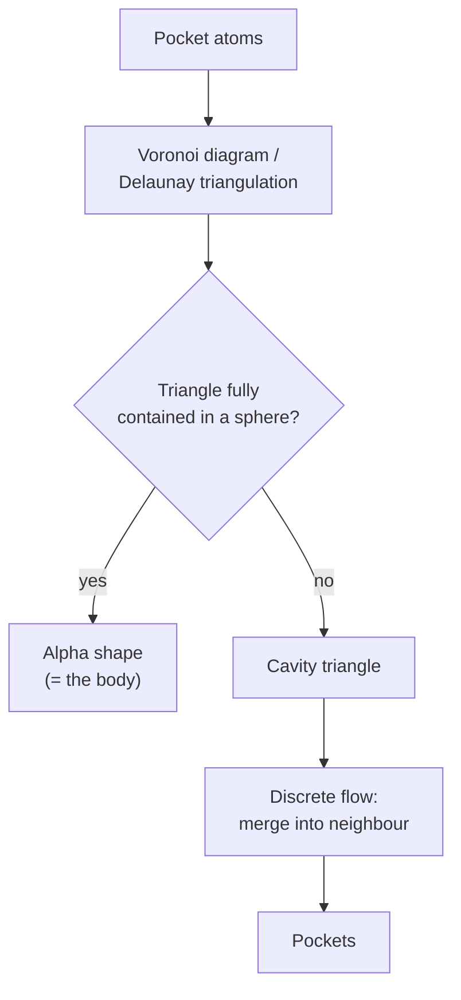

# CAST and alpha shapes

[[concepts/binding-site-detection|Binding-site detection]] by computational geometry: build
the Voronoi diagram of the pocket atoms, derive the alpha shape, and treat everything the
alpha shape fails to cover as cavity.

## Why it matters

CAST is the only method in the lecture that rests on an exact geometric construction rather
than on sampling or thresholds. The alpha shape gives a principled definition of "the shape
of a point set at resolution α", so "cavity" becomes a derived notion instead of a tuned
one.

## Mechanics

```text
ALGORITHM CAST
INPUT : atoms lining the region of interest
OUTPUT: pockets

A) compute the VORONOI DIAGRAM of the pocket atoms
B) the boundary lines through the atom centres describe the convex hull;
   ALPHA SHAPES = the triangles that are completely contained in spheres
   all other triangles are CAVITIES
C) triangles are merged with the neighbouring triangle
   using a DISCRETE FLOW METHOD
```


*Triangles that the probe sphere cannot fill are exactly the empty space; discrete flow assembles them into connected pockets.*

The discrete flow step is what turns a set of individual empty triangles into a *pocket*:
each cavity triangle flows to its neighbour in the direction of increasing emptiness, and
triangles that flow to the same sink form one pocket.

Reported accuracy in the notes: **74 % (3)** — i.e. the true site is among the top three
predictions in about three-quarters of cases (see
[[concepts/binding-site-prediction-evaluation]]).

## Caveats

- **Finds only pockets whose opening is smaller than every cross-section through the
  pocket.** A funnel that widens towards the outside is invisible to the method. This is the
  signature Voronoi failure mode.
- Depends on which atoms are declared "pocket atoms" in the first place.
- Numerically delicate: degenerate Delaunay configurations are common in protein structures.

## See also

- [[concepts/binding-site-detection]]
- [[concepts/surfnet]]
- [[concepts/pass-algorithm]]
- [[concepts/molecular-surfaces]]
- [[concepts/binding-site-prediction-evaluation]]

## Sources

- [[sources/ciw-06-flexible-docking-binding-sites-and-fragment-spaces]] (p. 10)
