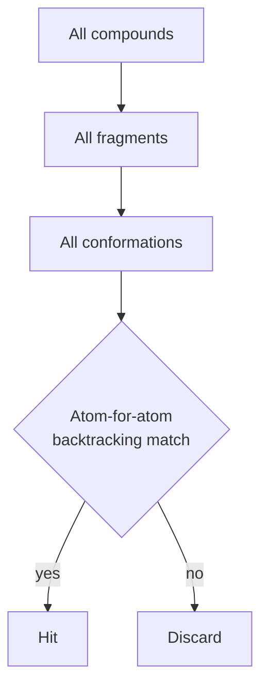

# CATALYST

A 3D database search system in which the pharmacophore acts as a **filter** over
pre-enumerated conformers, combined with additional shape and text-based criteria.

## Why it matters

CATALYST is the straightforward baseline for [[concepts/pharmacophore-matching]]: enumerate
everything, then backtrack. Its cost profile — huge conformer storage, cheap query —
is the opposite of [[concepts/directed-tweak]].

## Mechanics

The query is more than geometry:

- the **pharmacophore** is used as a filter, plus
- **shape descriptors**, plus
- **text-based boundary conditions** (e.g. property or annotation constraints).

```text
ALGORITHM CatalystMatch
INPUT   pharmacophore P with tolerances, conformer database
OUTPUT  matching molecules

FOR each compound:
    FOR each fragment:
        FOR each stored conformer:                  // hierarchical scan
            // atom-for-atom matching
            backtrack over all pairwise distance-compatible
                assignment options of atoms to P's points
            IF a complete assignment exists within tolerances:
                // tolerances permit small adaptation of the conformation
                MAP := yes; REPORT
            ELSE:
                MAP := no
```


*The hierarchical scan narrows compound → fragment → conformer before the expensive combinatorial matching begins.*

The tolerances serve a second purpose beyond absorbing measurement error: they allow a
stored conformer to be **adjusted slightly** so that a near-miss becomes a match.

## Caveats

- Requires the full conformer ensemble to exist on disk — the bottleneck is storage and
  the completeness of [[concepts/conformation-generation]], not the matching.
- Backtracking over all pairwise distance-compatible assignments is exponential in the
  number of pharmacophore points; small P is essential.

## See also

- [[concepts/pharmacophore-matching]]
- [[concepts/caveat-algorithm]]
- [[concepts/directed-tweak]]
- [[concepts/conformation-generation]]

## Sources

- [[sources/ciw-05-pharmacophores-qsar-and-docking]] (p. 4)
