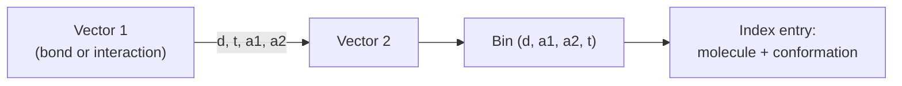

# CAVEAT

A 3D search system that indexes molecules by the **relative geometry of pairs of vectors**,
where a vector is a bond or a directed interaction.

## Why it matters

CAVEAT changes the primitive. Instead of *points* with distances, it uses *vectors* with
distance **and orientation** — which lets one query ask two very different questions with
the same machinery: find a linker fragment (vectors = bonds) or find a pharmacophore
(vectors = interactions).

## The four geometric parameters

Every ordered pair of vectors is characterised by:

| Symbol | Meaning |
|---|---|
| d | distance between the vectors |
| t | torsion angle |
| a₁, a₂ | the two opening angles |


*A vector pair is reduced to four numbers, which are quantised into a bin; the bin is the index key.*

## Mechanics

```text
ALGORITHM CaveatBuild
FOR each molecule m:
    V := selected vectors of m            // bonds, directed interactions, ...
    FOR each conformation c OF m:
        FOR each pair (v1,v2) IN V×V:
            store (m,c) under bin(d, t, a1, a2)

// Bin management: uniform bins for d, a1, a2.
// The bin size of t depends on a2.

ALGORITHM CaveatSearch
INPUT   query = set of vectors (pair list + tolerance ranges)
OUTPUT  molecules satisfying the whole query

FOR each vector pair of the query:
    determine the valid bins (given the tolerance ranges)
traverse the hit lists in molecule order:
    find molecules that contain ALL queried vector pairs
FOR each molecule found:
    test whether the entire query is satisfied
        (i.e. the combination of vector pairs is simultaneously realisable)
```

Two stages, and the second matters: containing every pair individually does **not** imply
the pairs are mutually consistent, so a verification pass is required. This is the same
filter-then-verify structure as substructure screening in
[[concepts/subgraph-isomorphism]].

## The two applications

| Vectors are… | Query finds… |
|---|---|
| bonds | **linker fragments** — scaffolds that present substituents in a given relative geometry |
| interactions | **pharmacophores** |

## Caveats

- Making the torsion bin size depend on a₂ is a geometric correction (the torsion angle
  becomes ill-conditioned as the opening angle approaches collinearity), but the notes do
  not give the functional form → [[open-questions]].
- Storage grows with (number of vectors)² × (number of conformations).

## See also

- [[concepts/pharmacophore-matching]]
- [[concepts/linkers-and-chains]]
- [[concepts/atom-pair-and-triplet-descriptors]]
- [[concepts/pharmer-algorithm]]

## Sources

- [[sources/ciw-05-pharmacophores-qsar-and-docking]] (p. 5)
