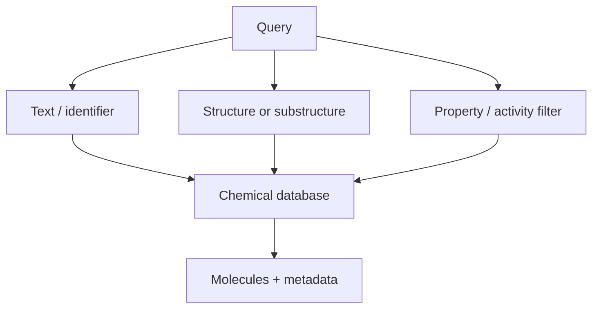

# Chemical Databases and Search Engines

Chemical databases store molecular structures with chemical, biological, synthetic and legal metadata so molecules can be searched, compared and modelled.

## Why it matters

They supply training data for [[concepts/qsar]], candidate pools for [[concepts/virtual-screening]] and evidence for lead optimisation.

## How it works

```text
PROCEDURE ChemicalDatabaseSearch(query Q, database DB)
  INPUT : text, property, structure, substructure or similarity query
  OUTPUT: matching molecules and metadata

  standardise Q into DB representation
  choose search mode
  retrieve candidate records
  filter by availability, biological profile or patents
  return structures, identifiers and annotations
```


*Chemical search combines molecular graph search with metadata filtering.*

## Practical notes

| Resource | Emphasis in the notes |
|---|---|
| PDB | biomacromolecule structures, especially proteins |
| ChEMBL | molecules and biological profiles |
| ZINC | commercially obtainable substances |
| PubChem | public screening and small-molecule data |
| BRENDA | enzymes |
| DrugBank | drugs / active pharmaceutical ingredients |
| SureChEMBL | molecules and patents |
| CSD | small-molecule and organometallic crystal structures |

Search engines named: ChemSpider, eMolecules and SciFinder. See [[entities/chemical-database-catalog]].

## Limitations / caveats

- The same molecule can have different identifiers and annotations across databases.
- Salts, tautomers, stereochemistry and missing hydrogens can change exact-match results.

## See also

- [[entities/chemical-database-catalog]]
- [[concepts/markush-structures]]
- [[concepts/subgraph-isomorphism]]

## Sources

- [[sources/gci-01-foundations-of-cheminformatics]] (pp. 3–5, 8)
