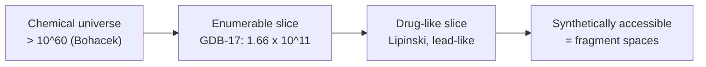

# Chemical space

**Chemical space** = the part of the chemical universe whose molecules lie within a defined
value range with respect to a set of descriptors.

## Why it matters

[[concepts/de-novo-design]] has to search *somewhere*. The chemical universe is far too
large, so the search space is restricted by physico-chemical criteria — and the definition
of "restricted" is itself a design decision with enormous consequences.

## How large?

```text
Bohacek:   chemical space > 10^60 molecules
GDB-17  :  1.66 × 10^11 molecules   (an actual enumeration)
```

```text
scale sketch (log10 of the number of molecules)

 0        6        11            60
 |--------|--------|-------------|
 drug     ZINC   GDB-17        Bohacek
 in use   DBs   enumerated     estimate
```


*Each step down is a different restriction: size, drug-likeness, and finally whether anyone can actually make the molecule.*

### GDB-17 — enumerating the organic-chemical space

```text
ALGORITHM GDB-17 (sketch)
  elements: C, N, O, S, halogens
  enumerate graphs with ≤ 17 nodes
  convert into hydrocarbons
  insert bond types
  substitute C → N and C → O
  → 1.66 × 10^11 molecules
```

Note what this is: [[concepts/subgraph-isomorphism|graph]] enumeration followed by chemical
decoration. Seventeen heavy atoms is already smaller than most drugs, and the result is
still 10¹¹ molecules — which is why nobody enumerates further.

## Restriction criteria

### Lipinski's Rule of 5

```text
Molecules that violate at least TWO of the criteria have a high
probability of being poorly ORALLY BIOAVAILABLE:

    size            MW          > 500 D
    lipophilicity   logP        > 5
    H-bond donors   #H-donors   > 5
    H-bond acceptors #H-acceptors > 10
```

The rule is a coarse, purely descriptor-based proxy for the absorption part of
[[concepts/admet]], built on [[concepts/lipophilicity-and-logp]] and counts of
[[concepts/hydrogen-bond]] partners. It predicts *failure*, not success.

### Oprea — lead-like space

A tighter envelope than Ro5: lead-like molecules are deliberately smaller and less lipophilic
than drugs, because optimisation only ever adds mass and logP (cf.
[[concepts/lead-optimization-heuristics]]).

## Caveats

- Ro5 is a statistical observation about oral drugs, not a law; whole classes (natural
  products, macrocycles, antibiotics) violate it and work.
- A descriptor-defined space contains vast numbers of molecules nobody can synthesise —
  which is exactly the gap [[concepts/fragment-spaces]] closes.
- The 10⁶⁰ figure is an estimate with no agreed derivation; it is useful as an order of
  magnitude only.

## See also

- [[concepts/de-novo-design]]
- [[concepts/fragment-spaces]]
- [[concepts/admet]]
- [[concepts/lipophilicity-and-logp]]
- [[concepts/lead-optimization-heuristics]]
- [[concepts/combinatorial-libraries]]

## Sources

- [[sources/ciw-06-flexible-docking-binding-sites-and-fragment-spaces]] (p. 20)
