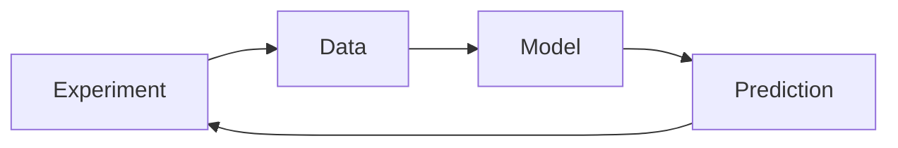

# Cheminformatics

Cheminformatics (Chemieinformatik) is the application of informatics methods to solve chemical problems.

## Why it matters

It converts structures, properties and transformations into searchable data and predictive models used in [[concepts/drug-discovery-pipeline]].

## How it works

```text
PROCEDURE CheminformaticsLearningCycle(question Q)
  INPUT : chemical question and measured examples
  OUTPUT: predictions and refined model

  examples <- measure molecules relevant to Q
  records <- standardise structures, properties and transformations
  model <- fit relationship between representation and measured property
  predictions <- apply model to untested molecules
  select new experiments from predictions
  repeat until useful for the decision
```


*Cheminformatics operationalises the experiment-data-model-prediction loop.*

## Practical notes

- GCI distinguishes cheminformatics from computational chemistry by emphasis: data handling and prediction vs direct molecular modelling.
- In drug design, it mainly supports lead generation and lead optimisation.

## Limitations / caveats

- Inductive models only generalise within represented chemical space.
- Prediction quality depends on database curation and representation choices.

## See also

- [[concepts/chemical-databases-and-search-engines]]
- [[concepts/molecular-graphs]]
- [[concepts/chemical-workflow-systems]]
- [[concepts/qsar]]

## Sources

- [[sources/gci-01-foundations-of-cheminformatics]] (pp. 1–2, 6)
