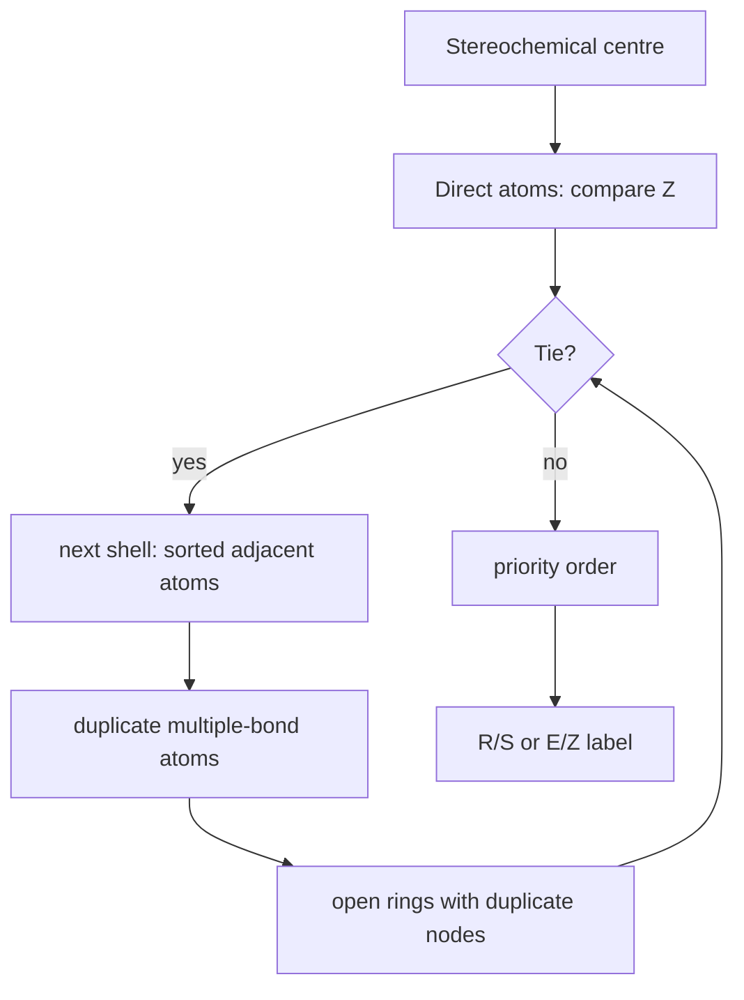

# CIP Sequence Rules

CIP sequence rules (Cahn-Ingold-Prelog rules; **CIP-Regeln**) assign priorities to substituents so tetrahedral centres and double bonds can be labelled R/S or E/Z.

## Why it matters

CIP priorities are the bridge between a labelled molecular graph and stereochemical descriptors used by [[concepts/smiles]], [[concepts/inchi-and-inchikey]] and [[concepts/molecular-structure-and-stereochemistry]]. GCI part 3 treats the rules as a graph traversal over substituent trees rather than as a drawing convention.

## How it works

1. Rank directly attached atoms by atomic number.
2. For isotopes of the same element, the larger mass number has higher priority.
3. If directly attached atoms tie, compare the next sphere of adjacent atoms as sorted lists.
4. Duplicate atoms across double and triple bonds before comparison.
5. Open rings by duplicate atoms; stop when a ring path would revisit an atom for the second time.
6. For a double bond, compare substituents on each side: same side of the two higher-priority substituents gives Z, opposite side gives E.
7. For a tetrahedral stereocentre, the ordered substituents give R/S after orienting the lowest-priority substituent away from the viewer.

```text
ALGORITHM CIPRankSubstituents(molecule G, centre c)
  INPUT : molecular graph G and stereogenic centre c
  OUTPUT: substituents in descending CIP priority

  roots <- atoms directly attached to c that participate in the stereochemical unit
  for each root r in roots:
      tree[r] <- BuildCIPSubstituentTree(G, centre = c, root = r)
      expand multiple bonds by adding duplicate atoms
      expand ring paths by adding duplicate atoms, stopping paths seen twice
  sort roots by CompareCIPTrees(tree[a], tree[b])
  return roots
```

```text
PROCEDURE BuildCIPSubstituentTree(G, centre c, root r)
  INPUT : molecular graph, stereocentre c, substituent root r
  OUTPUT: rooted substituent tree for recursive comparison

  create root node representing r, reached from c
  queue <- [(root, previous = c, pathAtoms = {c, r})]
  while queue not empty:
      node, previous, pathAtoms <- dequeue
      for each neighbour x of node.atom except previous:
          if bond(node.atom, x) is double or triple:
              attach duplicate copies required by the bond order
          if x in pathAtoms:
              attach duplicate node x and do not continue along that path
          else:
              attach ordinary child x
              enqueue(child, node.atom, pathAtoms ∪ {x})
  return tree
```

```text
ALGORITHM CompareCIPTrees(Ta, Tb)
  INPUT : two substituent trees
  OUTPUT: which substituent has higher priority, or tie

  for level k from 0 outward:
      La <- atoms at level k of Ta, sorted by decreasing atom priority
      Lb <- atoms at level k of Tb, sorted by decreasing atom priority
      for position p from 1 to max(length(La), length(Lb)):
          compare atomic number, then isotope mass, then duplicate status
          if La[p] outranks Lb[p]: return Ta higher
          if Lb[p] outranks La[p]: return Tb higher
  return tie
```


*CIP priority is a recursive comparison of substituent trees around the stereochemical unit.*

## Practical notes

- The notes propose caching comparison results, because the same substituent-tree comparisons recur during sorting.
- Sorting each adjacency list with `CompareBonds` creates a deterministic traversal order.
- Precomputed atom invariants or automorphism classes, for example Morgan-style ranks from [[concepts/morgan-canonicalization]], can reduce repeated comparisons.

## Limitations / caveats

- The source explains the graph procedure but does not specify every modern CIP rule extension.
- R/S assignment depends on the 3D orientation convention after priorities are known; the notes focus on priority ordering.

## See also

- [[concepts/molecular-structure-and-stereochemistry]]
- [[concepts/molecular-canonicalization]]
- [[concepts/smiles]]
- [[concepts/inchi-and-inchikey]]

## Sources

- [[sources/gci-03-stereochemistry-rings-substructure-and-mcs]] (pp. 1-5)
