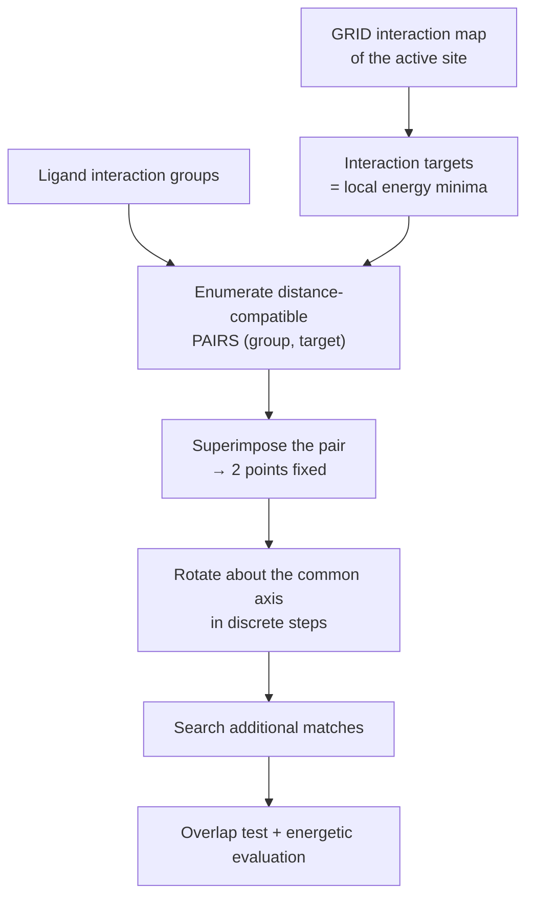

# CLIX

A rigid-body docking algorithm that matches **interaction groups** of the ligand to
**interaction targets** found in a GRID interaction map of the active site, then optimises
the remaining rotational degree of freedom by discrete scanning.

## Why it matters

CLIX changes the primitive from *shape* to *interaction*. DOCK matches atoms to spheres —
pure sterics; CLIX matches functional groups to energetic minima — chemistry first. The
GRID map it uses is exactly the field computation of [[concepts/comfa]], reused for a
different purpose.

## Mechanics

```text
SETUP:
   compute an INTERACTION MAP in the active centre (GRID)
   and identify INTERACTION GROUPS in the ligand

ALGORITHM CLIX
1. identification of interaction TARGETS in the interaction map
       = local energetic minima for different probes
2. enumeration of all PAIRS of distance-compatible matches
       of targets and groups
3. superposition of the groups / targets, then
   optimisation of the rotation around the common axis by
   rotating in DISCRETE steps:
        → search for additional matches
        → overlap test, energetic evaluation
```


*Two matched points leave exactly one rotational degree of freedom, and CLIX simply scans it.*

The geometric insight is the efficiency argument:

```text
place on 2 points   →   the pose is fixed up to rotation about the line
                        joining them  (1 remaining DOF)
rotate              →   scan that single angle in discrete steps
score               →   evaluate at each step
```

Using **pairs** instead of the 4-tuples of [[concepts/dock-algorithm]] means far fewer
seeds to enumerate; the price is one extra dimension to scan, which is cheap because it is
only one angle.

## Caveats

- Discrete rotation steps can step over a narrow optimum.
- Depends entirely on the quality of the interaction map: a missed local minimum is a
  missed binding mode.
- Rigid-body; ligand flexibility must come from an ensemble.

## See also

- [[concepts/docking]]
- [[concepts/kuhl-algorithm]]
- [[concepts/dock-algorithm]]
- [[concepts/comfa]]
- [[concepts/scoring-functions]]

## Sources

- [[sources/ciw-05-pharmacophores-qsar-and-docking]] (p. 28)
