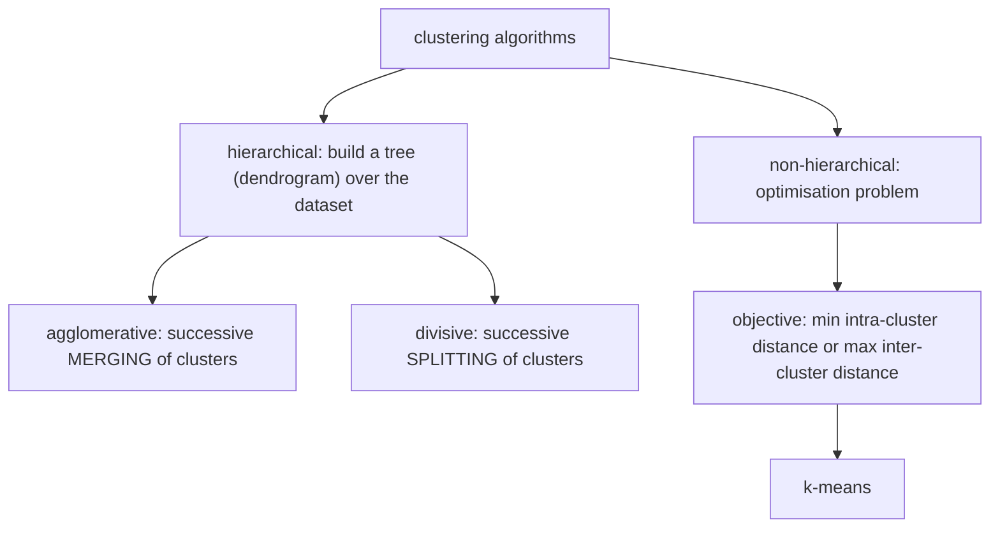

# Clustering of Molecules

**Grouping a dataset according to a similarity measure.** A method of *unsupervised
learning*: recognising common properties **without explicit training sets**.

(Contrast: **supervised learning** — labelled, with a training set.)

## Applications

- selecting molecules with which a database should be **extended** (fill the gaps)
- selecting molecules **for screening** (pick one representative per cluster)
- **analysis of screening data** (do the hits fall into chemotypes?)

All three rest on the same premise: a cluster is a redundancy, so one member per cluster
carries almost the same information as all of them.

## Taxonomy of algorithms

*Two families, split by whether the result is a nested hierarchy or a flat partition.*

| Family | Definition |
|---|---|
| **Hierarchical** | construction of a tree structure (**dendrogram**) over the dataset |
| — *agglomerative* | built up by successively merging clusters |
| — *divisive* | built by successively splitting clusters — ⚠️ **generally worse**, but **parallelisable** |
| **Non-hierarchical** | an optimisation problem: objective function = minimal intra-cluster distance or maximal inter-cluster distance |

## Comparison

| | Partitional | Hierarchical |
|---|---|---|
| What it does | divides the dataset into distinct groups based on similarity/distance measures | organises data points into a hierarchy of nested clusters forming a tree-like structure |
| Assignment | each point to exactly one cluster | bottom-up or top-down |
| **+** | simple; scalable; flexible | no need to know the number of clusters; captures complex relationships; visualisation |
| **−** | sensitive to initial conditions; hard to determine the number of clusters; cannot handle overlapping clusters | complex; lacks scalability; difficult to interpret large dendrograms |
| Used when | the number of clusters **is known** | the number of clusters is **unknown** |

## See also

- [[concepts/hierarchical-clustering]]
- [[concepts/k-means-clustering]]
- [[concepts/jarvis-patrick-clustering]]
- [[concepts/kohonen-maps]]
- [[concepts/high-throughput-screening]]
- [[exercises/ciw-e5-feature-trees]]

## Sources

- [[sources/ciw-04-descriptor-evaluation-clustering-and-superposition]] (pp. 8, 12)
