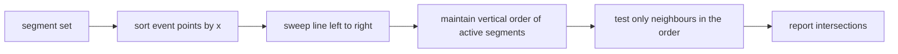

# Collision Detection and the Scan-Line Principle

Finding, and then removing, overlapping elements in a structure diagram. Formally this is
the **line-segment intersection problem**.

## Problem statement

```text
given : a set of line segments  s_i = (p_i, q_i),  i = 1, …, N
intersection test         : do two given segments intersect?
intersection enumeration  : determine all pairs of intersecting segments
```

## Naive algorithm

```text
for each pair (s_i, s_j):
    test s_i, s_j for intersection        // O(N²)
```

There can be `Ω(N²)` intersections, so `O(N²)` is optimal in the worst case — but typical
molecule diagrams have very few crossings, which is what the scan-line method exploits.

## Scan-line principle

```text
a scan line sweeps across the plane and stores all segments it currently cuts

order relation  A ↑_x B  :  at x-coordinate x, segment A lies above segment B
```

Only segments that are **adjacent in this order** can become intersecting, so the number of
pair tests drops from all pairs to neighbouring pairs in a sorted structure.


*The sweep reduces the intersection search from all pairs to neighbouring pairs in the current vertical order.*

## Modifications for removing collisions

Once a collision is found, the layout is repaired locally:

- rotating a whole **prefabricated unit (PFU)**
- exchanging substituents
- changing the angle pattern
- shortening terminal bonds
- rotating bonds within a **chain drawing unit (CDU)**
- lengthening bonds
- changing bond angles

⇒ **Modifications outside a PFU are more advantageous for the overall layout** — a PFU is a
block that has already been optimised, so disturbing its interior costs more quality than
adjusting its surroundings.

## Caveats

- Collision *removal* is a local search: fixing one collision can create another, so the
  process iterates and is not guaranteed to converge to a crossing-free diagram.
- The order relation `↑_x` changes exactly at intersection points, which is why the sweep
  must re-sort at each event.

## See also

- [[concepts/structure-diagram-generation]]
- [[concepts/ring-system-layout]]
- [[concepts/protein-ligand-interaction-diagrams]]

## Sources

- [[sources/ciw-03-pattern-mining-diagrams-surfaces-and-reduced-graphs]] (p. 11)
