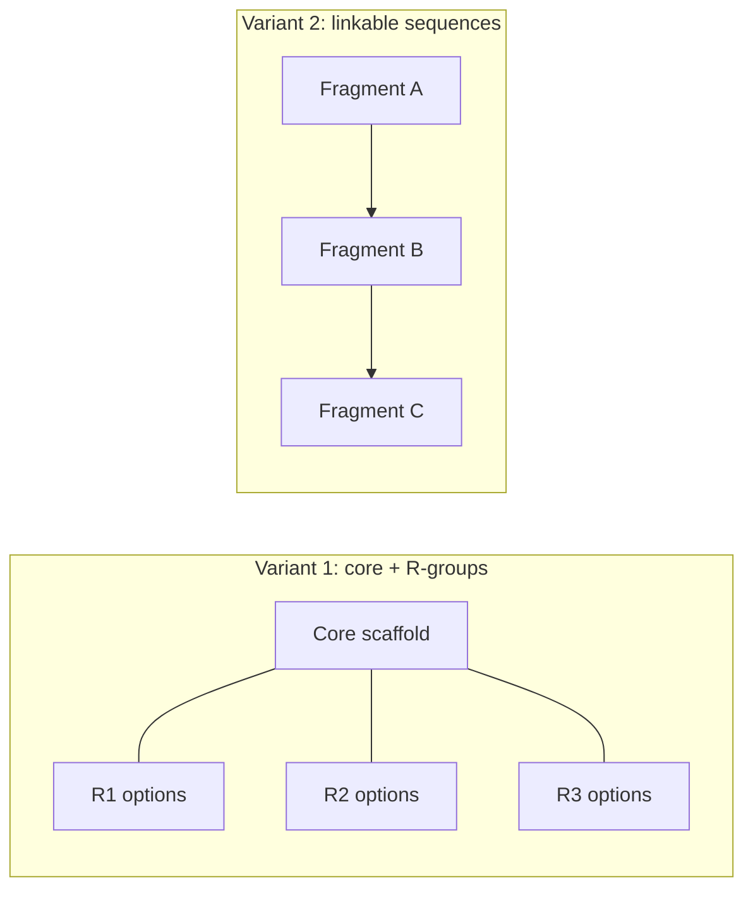

# Combinatorial libraries

Molecule collections built by combining fragments according to fixed synthesis rules, used
as the test set for [[concepts/high-throughput-screening]].

## Why it matters

HTS needs molecules — a lot of them. They come either from in-house databases or from
**combinatorial libraries (CombiLibs)**, which are far cheaper per compound because the
synthesis is systematic. The design question is which combinations to actually make.

## Two construction variants

```text
COMBILIBS: molecule fragments that can be combined
           according to fixed rules

VARIANT 1: a unified CORE fragment (given by the synthesis procedure)
           with R-groups, for which arbitrarily combinable
           alternatives exist

VARIANT 2: the library arises through SEQUENCES of
           linkable molecule fragments
```


*Variant 1 fixes a scaffold and varies substituents; variant 2 chains fragments together, which is the direct ancestor of fragment spaces.*

Variant 1 is the chemical realisation of the R-group table behind
[[concepts/free-wilson-analysis]] — the same combinatorial object, once as a synthesis plan
and once as a regression design matrix.

## Drawbacks of HTS

The marginal notes list why this is not a solved problem:

```text
- low success rate
- high cost
- coverage of the chemical space is weak
- very slow
- poorly optimised hits
```

These five complaints are the motivation for everything that follows:
[[concepts/fragment-based-drug-design]] answers the coverage and optimisability points, and
[[concepts/de-novo-design]] abandons screening altogether.

## Designing HTS libraries: SELECT

```text
DESIGN ASPECTS
    synthesis rules
    goal: SELECTION OF THE R-GROUPS
    all combinations of the chosen R-groups are synthesised
    diversity of the library

SELECT  (genetic algorithm)
    chromosome: encodes a combinatorial SUB-library
    crossover / mutation: exchange R-groups
    fitness:
        diversity of the library
      + deviation from a given physico-chemical property profile
```

The fitness function is the interesting part: it optimises a *set*, not a molecule. Two
competing pressures — spread out (diversity) and stay in range (property profile) — which
is precisely the tension between covering [[concepts/chemical-space]] and respecting
[[concepts/admet]] constraints.

## Caveats

- Full combinatorial synthesis means the library size is the product of the R-group counts;
  it grows out of reach immediately.
- Diversity is measured with descriptors, so "diverse" means diverse *in that descriptor
  space* — see [[concepts/clustering-of-molecules]].
- Combinatorial libraries are biased towards whatever chemistry is easy, not towards what
  binds.

## See also

- [[concepts/high-throughput-screening]]
- [[concepts/focused-libraries]]
- [[concepts/fragment-based-drug-design]]
- [[concepts/chemical-space]]
- [[concepts/free-wilson-analysis]]

## Sources

- [[sources/ciw-06-flexible-docking-binding-sites-and-fragment-spaces]] (p. 17)
