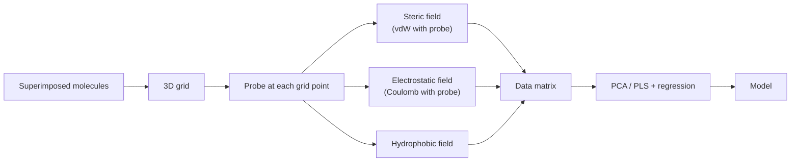

# CoMFA

**Comparative Molecular Field Analysis** (Cramer): embed superimposed molecules in a 3D
grid, compute interaction fields at every grid point, and regress those field values
against biological activity.

## Why it matters

CoMFA is the method that made 3D descriptors respectable. It replaced hand-chosen
substituent constants with a dense, physically meaningful sampling of the space around the
ligand — and in doing so created the "far more variables than observations" problem that
[[concepts/partial-least-squares]] was imported to solve.

## Prerequisites

```text
→ molecules bind mainly COMPETITIVELY to the same target protein
→ molecules have as WIDE a spectrum of affinities as possible
→ the structural superposition is known or computed
```

All three are binding constraints, not conveniences: without competition the activities are
not comparable, without a spread of affinities there is nothing to regress, and without an
alignment the grid values are meaningless.

## Method

```text
ALGORITHM CoMFA
1. embed the superimposed molecules in a 3D grid
2. compute fields at the grid points
3. correlate the field data at grid points with the biological activities
4. validate the model
```


*A probe atom is walked over every grid point; what it feels there becomes a column of the data matrix.*

## Computing the fields: GRID

```text
Computation of the interaction with a PROBE placed at the grid point:
    steric field        : van der Waals interaction of the probe with the molecule
    electrostatic field : Coulomb interaction of the probe with the molecule
    also a hydrophobic field

PROBLEM: the potentials (steric, electrostatic) are INFINITELY LARGE near the atoms
SOLUTION: use of capped functions (Gauss curve)
```

The divergence is the Lennard-Jones r⁻¹² term of [[concepts/lennard-jones-potential]] and
the Coulomb r⁻¹ term meeting a grid point that happens to lie inside an atom. Capping is a
patch, and the numerical trouble it leaves behind is exactly what
[[concepts/comsia]] was designed to remove.

## Correlation with biological data

```text
DATA MATRIX:  rows    = molecules
              columns = field contributions f(x,y,z) for all field types

FREE VARIABLES: a_{f,x,y,z} = RELEVANCE of the entry f(x,y,z)
                              for the biological effect
                → an EXPLANATION, not a "contribution"

MODEL:
        log 1/C  =    Σ        Σ           a_{f,x,y,z} · f(x,y,z)  +  a
                   field f  grid point x,y,z

PROBLEM: # free variables  >>  # biological data
         → reduce the number of free variables: PCA, PLS
```

The marginal note in the source is worth preserving: a **small** a_{f,x,y,z} at a grid point
with **large variance** across the series can still account for large affinity differences.
Coefficient magnitude alone does not rank importance.

## Caveats

- Grid spacing, grid extent, probe type and capping threshold are all free choices that
  change the model.
- Steep potentials make the model numerically unstable and the contour maps hard to read
  geometrically.
- The alignment dominates the result (see [[concepts/3d-qsar]]).

## See also

- [[concepts/3d-qsar]]
- [[concepts/comsia]]
- [[concepts/partial-least-squares]]
- [[concepts/principal-component-analysis]]
- [[concepts/lennard-jones-potential]]

## Sources

- [[sources/ciw-05-pharmacophores-qsar-and-docking]] (p. 19)
