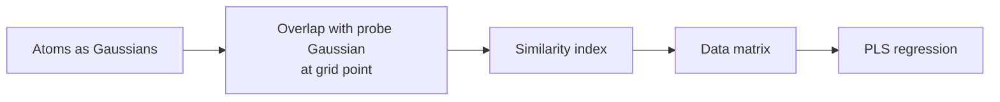

# CoMSIA

**Comparative Molecular Similarity Index Analysis**: like [[concepts/comfa]], but at each
grid point it measures the **similarity** of the molecule to the probe instead of the
interaction energy.

## Why it matters

CoMSIA exists to fix three concrete defects of CoMFA, all of which come from the same
cause — unbounded potentials.

```text
CoMFA DISADVANTAGES:
    - potentials have very steep flanks
    - geometrically difficult to interpret
    - numerically unstable
```

## Method

```text
CoMSIA: molecules are compared DIRECTLY (with the probe), as in CoMFA.

METHOD:
    at each grid point, the SIMILARITY of the molecule with the probe
    is determined
        → similarity index := OVERLAP OF GAUSSIAN FUNCTIONS
```


*Replacing an energy by a Gaussian overlap bounds the value at every grid point, and that single change fixes all three CoMFA defects.*

The Gaussian representation is the same device as in
[[concepts/gaussian-molecular-representation]] and [[concepts/seal-algorithm]]: smooth,
differentiable, and finite everywhere.

## Advantages

| CoMFA | CoMSIA |
|---|---|
| steep flanks | **flatter flanks** |
| potential diverges at atoms → capping required | **defined finite maximum, therefore no capping necessary** |
| fields geometrically hard to interpret | **fields geometrically easier to interpret** |

Because the maximum is finite and located *at* the atom, a CoMSIA contour can be read
directly as "put an atom of this type here", whereas a CoMFA contour sits in the repulsive
shell around the atoms.

## Caveats

- Smoothing loses resolution: two nearby features can merge into one broad region.
- The Gaussian width is an extra free parameter.
- Everything CoMSIA shares with CoMFA — alignment dependence, variable/observation ratio —
  remains.

## See also

- [[concepts/comfa]]
- [[concepts/3d-qsar]]
- [[concepts/gaussian-molecular-representation]]
- [[concepts/partial-least-squares]]

## Sources

- [[sources/ciw-05-pharmacophores-qsar-and-docking]] (p. 22)
