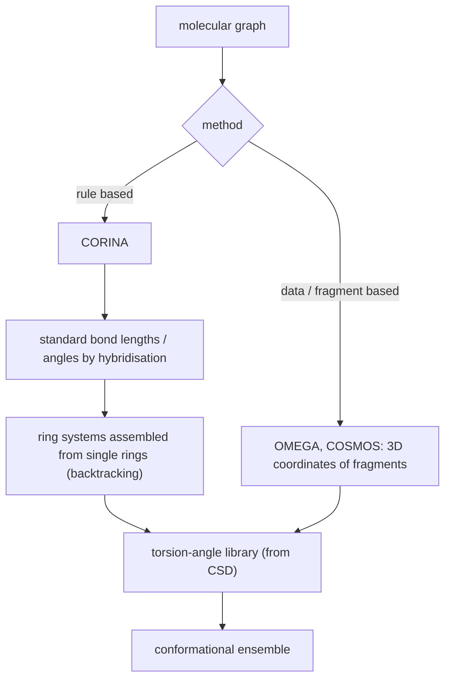
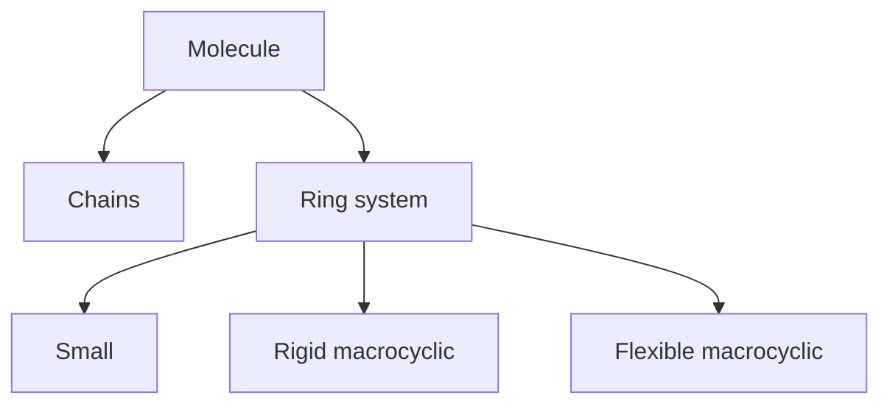

# Conformation Generation

Converting a molecular graph into a **low-energy conformation** — i.e. generating 3D
Cartesian coordinates from a 2D structure.

## Requirements

- many different elements
- correct stereochemistry
- fast and automated
- high quality of the models
- high conversion rate

## Conceptual problems

- Bond lengths and bond angles have a **global minimum**, and the optimal values are known
  ([[concepts/vsepr-model]]) — **but**:
- **rotatable bonds have several torsion angles as local minima**;
- **ring closures** generate complex geometric boundary conditions.


*Bond lengths and angles are set from rules; the real search happens over torsion angles and ring conformations.*

## Data-driven conformation generation

| Approach | Mechanism |
|---|---|
| **Rule based** | information from crystal data: bond lengths and angles — **CORINA** |
| **Data / fragment based** | database of 3D coordinates of various fragments: `A + B + C → Mol-3D` — **OMEGA**, **COSMOS** |

## CORINA

**Decomposition of the molecule:**


*CORINA treats each structural class with a different strategy.*

- Bond lengths and angles of **acyclic** molecular parts are set to **standard values
  matching the hybridisation state**.
- For **rings**, different **templates** are created and used, ranked by strain energy:

```text
  cyclohexane-type ring   ~ 27 kJ/mol
  strained bicyclic       ~ 50 kJ/mol
```

- **Ring systems are assembled from single rings** (backtracking over all combinations).
- **Macrocycles** are first converted into a **"superstructure"**; the individual ring
  conformations are inserted afterwards.

## Generating conformational ensembles

**Torsion-angle libraries:**

- derived from **crystal structures of small organic molecules** (**CSD** — the Cambridge
  Structural Database)
- a **hierarchical system of torsion patterns**: the pattern is matched from the most
  specific description of the bond environment downwards, so a common motif
  (e.g. an ester versus a generic ether) gets its own well-measured angle distribution

```text
example:   CO–…  ┬→ ester  → [ energetically favourable torsion angles ]
                 └→ ether  → [ … ]
```

Sampling torsions from these empirical distributions, instead of scanning them uniformly,
is what keeps the ensemble small while still covering the geometries that actually occur.

## See also

- [[concepts/molecular-conformation]]
- [[concepts/vsepr-model]]
- [[concepts/flexible-superposition]]
- [[concepts/ring-perception]]
- [[concepts/atom-pair-and-triplet-descriptors]]

## Sources

- [[sources/ciw-04-descriptor-evaluation-clustering-and-superposition]] (pp. 20–21)
