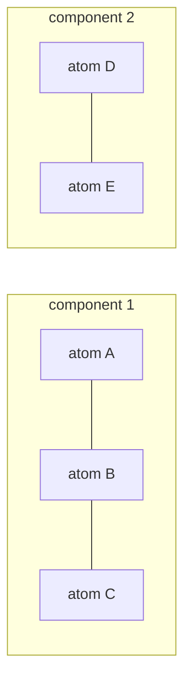

# Connected Components

Connected components are the equivalence classes of atoms that can reach one another by paths in the molecular graph.

## Why it matters

Molecular files and reaction-like records can contain disconnected fragments; graph algorithms such as [[concepts/subgraph-isomorphism]], [[concepts/ring-perception]] and [[concepts/maximum-common-substructure]] need to know whether they are operating on one covalently connected molecule or several components.

## How it works

Two nodes are connected if a path exists between them. Connectedness is reflexive, symmetric and transitive, so it partitions the graph into connected components (**Zusammenhangskomponenten**, CCs).

```text
ALGORITHM ConnectedComponents(G)
  INPUT : undirected molecular graph G = (V,E)
  OUTPUT: component label cc[v] and number n_cc

  for each v in V: cc[v] <- 0
  n_cc <- 0
  for each v in V:
      if cc[v] == 0:
          n_cc <- n_cc + 1
          DFSVisit(v, n_cc)
  return cc, n_cc

PROCEDURE DFSVisit(v, label)
  cc[v] <- label
  for each u in Adj[v]:
      if cc[u] == 0:
          DFSVisit(u, label)
  # complexity: O(|V| + |E|)
```


*DFS labels each covalently connected fragment with one component number.*

## Practical notes

- Component labels are useful before deciding whether a query should be matched inside one fragment or across multiple fragments.
- A disconnected graph has `n_cc > 1`; each CC can be processed independently for ring perception.

## Limitations / caveats

- Connected components do not distinguish salts, solvates or biologically meaningful complexes; they only reflect graph connectivity.

## See also

- [[concepts/molecular-graphs]]
- [[concepts/ring-perception]]
- [[concepts/subgraph-isomorphism]]

## Sources

- [[sources/gci-03-stereochemistry-rings-substructure-and-mcs]] (p. 9)
