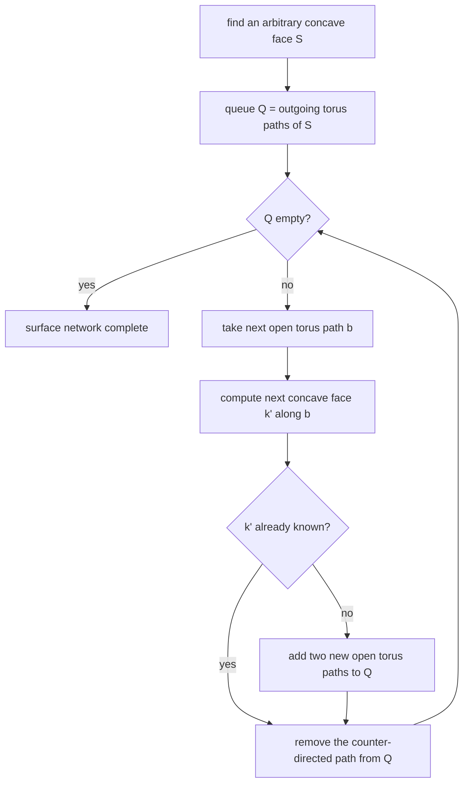

# Connolly Surface Algorithm

Michael Connolly's method for computing the **molecular surface**
([[concepts/molecular-surfaces]]) by a **gift-wrapping** traversal of the network of torus
paths.

## Two parts

| Part | Task |
|---|---|
| **Discrete part** | computation of the **network of torus paths** |
| **Analytical part** | computation of the surface segments (position, size, boundary lines) |

The split matters: the discrete part answers *which* patches exist and how they connect —
that is the graph implied by the "three touching points" observation in
[[concepts/molecular-surfaces]]. The analytical part then computes exact geometry for each
patch.

## Gift-wrapping algorithm

```text
ALGORITHM Connolly-GiftWrapping(atoms, probe radius)
  INPUT : VdW spheres, probe sphere
  OUTPUT: the network of surface patches

  # initialisation
  find an arbitrary concave face S as the starting point
  store all outgoing torus paths in a queue Q

  while Q ≠ ∅:
      choose the next open torus path b from Q
      compute the next concave face k' along the torus path b
      if k' is not yet known:
          insert two new open torus paths into Q
      always delete the counter-directed open torus path from Q
```


*A breadth-first wrap around the molecule: every torus path is traversed once from each side, and the second traversal closes it.*

The "always delete the counter-directed open torus path" step is the closure condition —
each torus path connects exactly two concave faces, so once both ends are known the path is
finished.

## Caveats

- Requires a starting concave face; for a molecule with no three mutually close atoms
  (e.g. a single atom) the concave case degenerates.
- The self-intersection problem of the molecular surface is **not** solved here — cusp
  trimming is a separate post-processing step.

## See also

- [[concepts/molecular-surfaces]]
- [[concepts/marching-cubes]]
- [[concepts/ball-pivoting-algorithm]]

## Sources

- [[sources/ciw-03-pattern-mining-diagrams-surfaces-and-reduced-graphs]] (p. 16)
