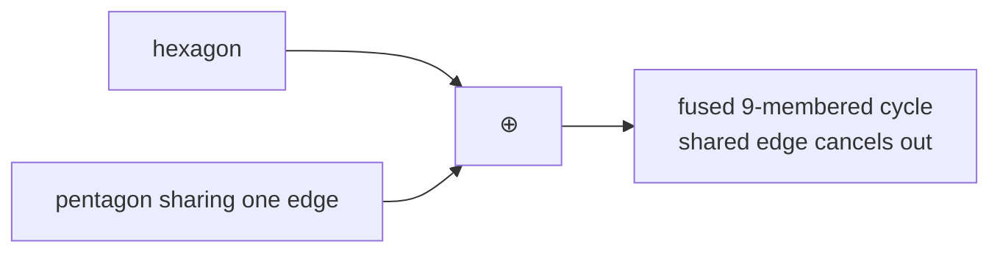

# Cycle Space and Cycle Basis

The algebraic framework that turns "how many rings does a molecule have?" into a question
about the **dimension of a vector space over GF(2)**.

## Cycles

> Let `G = (V,E)` be a graph and `C` a subgraph. **C is a cycle** exactly if every node in C
> has **even degree**. A cycle C is described by the edges it contains.

> A cycle C is **elementary** exactly if C is **connected** and every node has **degree 2**.

## Cycle addition

```text
C ⊕ C' = (C ∪ C') \ (C ∩ C')          # symmetric difference = XOR on edge sets
```

**Theorem.** The addition operation is **closed on cycles** (adding cycles yields a cycle).
It is **not** closed on the set of **elementary** cycles.


*Adding two elementary cycles that share an edge gives a larger cycle — still a cycle, but the shared edge disappears.*

## Covering

Let `C = {C₁,…,C_k}` be a set of cycles on `G = (V,E)`.

```text
E[C] = set of edges of all cycles  =  ⋃_{c ∈ C} ⋃_{e ∈ c} {e}
C covers G   ⟺   E[C] = E
```

## Cycle space

> The set `C(G)` of all cycles of a graph G is called the **cycle space**.

A set `B` of cycles is a **cycle basis** if:

1. Every cycle in G can be constructed by addition of cycles from B (**complete covering**):
   `∀c ∈ C(G) : ∃ B_c ⊆ B : ⊕_{b ∈ B_c} b = c`
2. No cycle in B can be constructed from the other cycles in B (**linear independence**):
   `∀c ∈ B : ¬∃ B_c ⊆ B \ {c} : ⊕_{b ∈ B_c} b = c`

⊕ defines a **vector space** over `C(G)`.

## Cyclomatic number

Every basis consists of exactly

```text
μ(G) = |E| − |V| + c(G)          cycles,   c(G) = number of connected components
```

`μ(G)` is the **cyclomatic number**: the **minimal number of edges whose removal turns G
into a forest** (spanning tree).

**Example:** a cube graph has μ = 5, but chemically one would say it has 6 rings.

> ⚠️ **Problem:** ambiguity for rings of equal size in symmetric arrangements —
> cyclomatic number ≠ number of chemical rings.

## Linear dependence, concretely

Cycles are represented by **edge vectors**:

| Cycle operation | Vector operation |
|---|---|
| ⊕ on cycles | **XOR** on edge vectors |
| ⊗ (multiplication) | **AND** on edge vectors |

> Let `B = {C₁,…,C_k}` be a set of cycles. A cycle C is **linearly dependent** if there is a
> vector `z ∈ {0,1}^k` with `C = ⊕_{i=1..k} (z_i ⊗ C_i)`, componentwise
> `C[a] = ⊕_{i=1..k} (z_i ⊗ C_i[a])`.

```text
ALGORITHM IsIndependent(B, C)
  INPUT : basis-so-far B as a matrix (rows = edges, cols = cycles), candidate cycle C
  OUTPUT: true if C is linearly independent of B

  M <- matrix(B) augmented with column C
  gaussianElimination(M)                 # over GF(2): XOR row operations
  return rank(M) > rank(matrix(B))       # i.e. M has full column rank
```

> A set B of cycles is linearly independent **⟺** the matrix formed from B has **full column
> rank** (Gauss).

## See also

- [[concepts/sssr-and-minimal-cycle-basis]]
- [[concepts/horton-algorithm]]
- [[concepts/relevant-cycles-and-vismara]]
- [[concepts/ring-perception]]

## Sources

- [[sources/ciw-02-substructure-search-and-ring-perception]] (pp. 12–13, 15)
