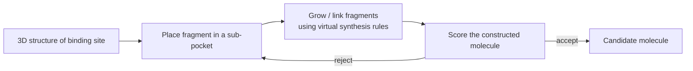
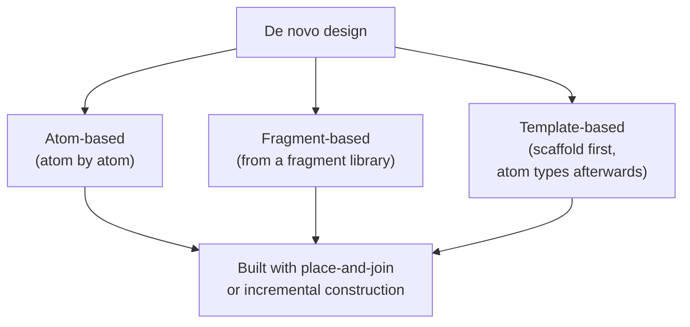

# De Novo Design

Computer-aided **construction** of active compounds on the basis of the 3D structure of the
protein — instead of selecting them from an existing database.

## Prerequisites

- 3D structure of the target protein
- libraries of **molecular fragments**
- rules for **virtual synthesis**


*De novo design builds a molecule fragment by fragment inside the pocket.*

```text
ALGORITHM DeNovoDesign(pocket P, fragmentLibrary F, rules R)
  INPUT : binding-site 3D structure, fragment library, virtual synthesis rules
  OUTPUT: set of constructed candidate molecules

  seeds <- placeFragments(F, subPockets(P))      # anchor fragments
  candidates <- []
  for each seed s in seeds:
      m <- s
      while not complete(m):
          f <- selectFragment(F, growthVector(m), R)   # R = chemically valid connections
          m <- connect(m, f)
          if score(m, P) < threshold: break            # prune
      if complete(m): candidates.append(m)
  return rank(candidates, scoringFunction)
```

Key difference from [[concepts/virtual-screening]]: the molecules do not exist yet, so
**synthetic accessibility** becomes a first-class constraint (the 6th boundary condition in
[[concepts/admet]]).

## Taxonomy *(lecture 6)*

> Idea: instead of searching in a molecule database, molecules are designed specifically to
> fit into the active site.

```text
PROBLEM: additional properties are hard to control
    - synthesisability
    - toxicity
    - ADME

TAXONOMY
  ATOM-BASED      : molecules are built atom by atom
  FRAGMENT-BASED  : molecules are built from a fragment library
  TEMPLATE-BASED  : fit a molecular scaffold, then fix the
                    chemical properties by assigning atom types

→ place & join and incremental-construction algorithms are used
→ examples: LUDI and MCSS
```


*The three families differ only in the granularity of the building block: atom, fragment, or whole scaffold.*

The granularity is a direct trade-off. Atom-based construction can reach any molecule but
produces mostly unsynthesisable ones; template-based construction guarantees a sensible
skeleton but can only ever decorate scaffolds it already knows. Fragment-based is the middle
ground and is the one that scales, because a fragment library plus connection rules *is* a
[[concepts/fragment-spaces|fragment space]] — which is how the synthesisability problem
stated above is eventually solved.

The construction algorithms are not new: they are exactly
[[concepts/place-and-join]] and [[concepts/incremental-construction-docking]] from docking,
run with the fragment library as the source of building blocks instead of a given ligand.
Search technologies for the resulting spaces are covered in
[[concepts/fragment-space-search]].

## See also

- [[concepts/lead-finding-strategies]]
- [[concepts/virtual-screening]]
- [[concepts/fragment-spaces]]
- [[concepts/fragment-space-search]]
- [[concepts/chemical-space]]
- [[concepts/fragment-based-drug-design]]
- [[concepts/incremental-construction-docking]]

## Sources

- [[sources/ciw-01-drug-action-and-molecular-interactions]] (p. 19)
- [[sources/ciw-06-flexible-docking-binding-sites-and-fragment-spaces]] (p. 19)
