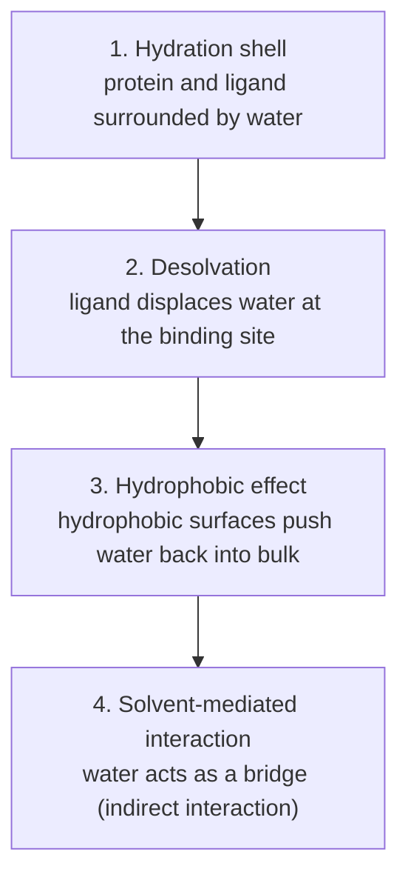

# Desolvation and the Role of Water

Protein and ligand are both wrapped in water; binding therefore always means **rearranging
the solvent**, not just forming protein–ligand contacts.

## Why it matters

Complex formation takes place in solvent. Intermolecular interactions between protein and
ligand must **compete with water interactions**. Ignoring water is the single most common
reason a naive scoring function overestimates affinity.

## Four solvent effects during binding


*Water is displaced, reorganised, or retained as a bridging molecule.*

1. **Hydration shell (Hydrathülle)** — protein and ligand are surrounded by water molecules.
   On binding, some of these waters are either displaced or moved into newly ordered
   positions in order to stabilise the new complex.
2. **Desolvation** — when the ligand binds the protein, it displaces water molecules from the
   environment of the binding site. This happens in order to enable more favourable
   protein–ligand interactions. It can lead to an entropy change, because the released water
   molecules gain more freedom.
3. **Hydrophobic effect** — hydrophobic regions of the ligand and protein cause water
   molecules to retreat; this contributes to the stability of the binding.
   → [[concepts/hydrophobic-effect]]
4. **Solvent-mediated interaction** — water molecules take over a bridging function between
   ligand and protein (indirect interaction).

## Balance sheet of hydrogen bonds

Complex formation must be judged by comparing H-bonds **before and after** binding:

| Case | Effect |
|---|---|
| Regular H-bond (ligand–protein replaces ligand–water) | number stays the same → small net effect |
| Additional H-bond enabled by water geometry | strong effect |
| Hydrophobic contact | additional H-bonds form in bulk water → positive effect |

```text
ALGORITHM HBondBalance(complex)
  INPUT : ligand L, protein P, water W, before/after binding
  OUTPUT: net enthalpic effect

  before <- count(HBonds(L,W)) + count(HBonds(P,W))
  after  <- count(HBonds(L,P)) + count(HBonds(L,W')) + count(HBonds(P,W'))
           + count(HBonds released waters form in bulk)
  return after − before        # ≈ 0 for a merely "regular" H-bond
```

Gas-phase association energies of individual groups can **exceed** the typical binding
affinities of ligands — the difference is exactly the cost of desolvation.

## Caveat

Burying an H-bond donor or acceptor without giving it a partner is strongly penalised;
see [[concepts/lead-optimization-heuristics]].

## See also

- [[concepts/protein-ligand-binding]]
- [[concepts/hydrophobic-effect]]
- [[concepts/enthalpy-entropy-compensation]]
- [[concepts/hydrogen-bond]]

## Sources

- [[sources/ciw-01-drug-action-and-molecular-interactions]] (pp. 7, 13)
