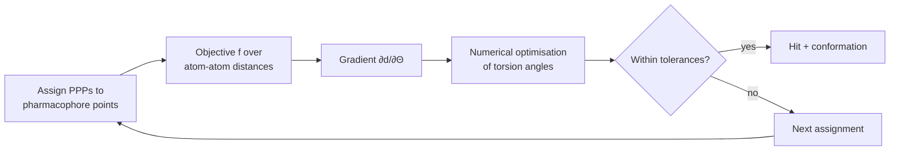

# Directed tweak (UNITY)

A pharmacophore-matching method that **does not enumerate conformations at all**: it treats
the torsion angles as continuous variables and numerically optimises them until the
pharmacophore constraints are satisfied.

## Why it matters

Every other system in [[concepts/pharmacophore-matching]] pays the
[[concepts/conformation-generation]] tax up front. Directed tweak moves that cost into the
query and, in exchange, considers the conformation space *directly* — no discretisation
error. The method was first developed for **protein loop prediction**, which is the same
mathematical problem: close a chain subject to distance constraints.

## Mechanics

```text
ALGORITHM DirectedTweak
INPUT   pharmacophore P with tolerances, molecule m
VARIABLES  torsion angles Θ of the rotatable chain

// objective function over atom-atom distances, e.g.
//   - deviation from prescribed target distances
//   - van der Waals contacts
//   - ring-closure conditions
f(Θ) := Σ (d_ij(Θ) − d_ij^target)^2 + penalties

FOR each assignment of the molecule's PPPs to P's points:      // enumerated
    generate conformations under the distance boundary conditions:
        atom-atom distance  d = g(Θ, ...)
        gradient            ∂d/∂Θ
        numerical optimisation minimises the deviation in f
    IF the pharmacophore is satisfied within the allowed tolerances:
        REPORT hit with the optimised conformation
```


*The combinatorial part (which atom plays which role) is still enumerated; only the geometric part is optimised.*

The availability of the analytic derivative ∂d/∂Θ is what makes this practical — the same
reason gradient-based methods dominate in [[concepts/seal-algorithm]] and
[[concepts/flexible-superposition]].

## Caveats

- Numerical optimisation finds a **local** minimum; a failed optimisation does not prove
  that no satisfying conformation exists.
- The assignment loop is still combinatorial.
- Energetic plausibility of the tweaked conformation is only enforced through the vdW and
  ring-closure penalty terms, not through a full force field.

## See also

- [[concepts/pharmacophore-matching]]
- [[concepts/conformation-generation]]
- [[concepts/molecular-conformation]]
- [[concepts/flexible-superposition]]
- [[concepts/protein-flexibility]]

## Sources

- [[sources/ciw-05-pharmacophores-qsar-and-docking]] (p. 6)
