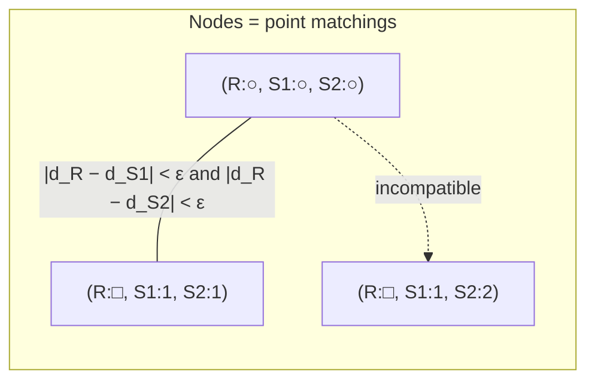

# DISCO

A pharmacophore-derivation algorithm that turns the search for a common pharmacophore into
a **clique search in a distance-compatibility graph**.

## Why it matters

DISCO is the first appearance of a pattern that recurs throughout structure-based design:
*candidate correspondences become nodes, geometric consistency becomes edges, and a maximal
mutually-consistent set is a clique.* The same construction drives
[[concepts/dock-algorithm]] and [[concepts/kuhl-algorithm]].

## Mechanics

```text
ALGORITHM DISCO
INPUT   n molecules, each with identified potential pharmacophore points
        tolerance ε (in Å)
OUTPUT  candidate common pharmacophores

1. Identify pharmacophore points in every molecule
2. Choose a reference molecule R
3. FOR each conformation of R:                       // one at a time
       build distance-compatibility graph D:
           NODES := matchings of potential pharmacophore points
                    = (n+1)-dimensional vectors, one entry per structure
           EDGES := {(u,v) : the two matchings are distance compatible}
                    i.e. corresponding intra-molecular distances agree within ε
       C := all cliques in D                          // Bron–Kerbosch
       FOR each clique c IN C:
           c describes a possible pharmacophore
           verify all stereoisomers                   // distances alone ignore chirality
       report c
```

A node bundles one candidate point from the reference and one from each of the other
structures. Two nodes are joined when the distance between the two points *inside every
molecule* is (approximately) the same — that is what "distance compatible" means.


*An edge certifies that two candidate correspondences can coexist geometrically; a clique is a fully consistent set, i.e. a pharmacophore.*

## Handling the two kinds of ambiguity

| Ambiguity | DISCO's treatment | Cost |
|---|---|---|
| Conformation of the molecules | enumerated — outer loop over conformations of R | increases runtime **t** |
| Stereoisomerism | checked afterwards, because only distances are used | **not** handled by the graph |

The notes flag this explicitly: enumerating conformations raises the runtime, while
stereochemistry is *not* captured by a distance-only model and must be verified separately.

## Caveats

- Clique enumeration is exponential in the worst case (Bron–Kerbosch); the graph size grows
  with the product of candidate-point counts across all molecules.
- The result depends on the choice of reference molecule R.
- ε trades false matchings against missed ones — the same tolerance dilemma as in
  [[concepts/atom-pair-and-triplet-descriptors]] binning.

## See also

- [[concepts/pharmacophore-derivation]]
- [[concepts/pharmacophore]]
- [[concepts/kuhl-algorithm]]
- [[concepts/dock-algorithm]]
- [[concepts/molecular-conformation]]

## Sources

- [[sources/ciw-05-pharmacophores-qsar-and-docking]] (p. 3)
