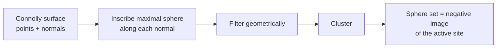

# DOCK

The classical rigid-body protein–ligand docking algorithm: represent the active site by a
set of **inscribed spheres**, then match ligand atoms onto sphere centres by shape.

## Why it matters

DOCK's sphere representation is one of the most reused ideas in the field — it reappears
unchanged in [[concepts/geometric-hashing-docking]]. It also turns docking into the same
distance-compatibility clique problem as [[concepts/disco-algorithm]], which is the unifying
observation of this lecture.

**Idea:** ligand orientation by **steric fit**, i.e. by shape alone.

## Protein representation: negative image by spheres

```text
ALGORITHM SphereGeneration
INPUT   Connolly surface of the protein, approximated by points p with
        surface normals n
OUTPUT  spheres filling the active site

FOR each surface point (p, n):
    generate a sphere k(p,n) such that:
        - p lies ON the surface of k(p,n)
        - the CENTRE of k(p,n) lies on the line  p + λn
        - k(p,n) has MAXIMAL radius without enclosing points of P

filter the spheres   (geometrically, e.g. by distance to a binding point)
cluster the spheres
```


*The spheres fill the cavity, so a ligand that fits the cavity is a ligand whose atoms sit near sphere centres.*

The spheres are grown into the *empty* space of the pocket — they are the complement of the
[[concepts/connolly-surface-algorithm]] surface, i.e. a negative image of the site.

## Matching ligand atoms to spheres

```text
DISTANCE COMPATIBILITY:
   two matches (l1,k1), (l2,k2) are distance-compatible  ⟺
        | d(l1,l2) − d(k1,k2) |  <  ε

GOAL: find matchings  M = {(l_i, k_i)}  with
        max_{i,j} { | d(l_i,l_j) − d(k_i,k_j) | }  <  ε
```

```text
ALGORITHM DOCK
1. recursive enumeration of all matchings M with |M| = 4
2. orientation of the molecule by an RMSD-fit routine
3. filtering of the orientations: overlap, stereochemistry, etc.
4. extension of the matching
5. optimisation of the orientation
       (fitting all ligand atoms onto the nearest spheres)
6. energetic evaluation → ΔG
```

Why **four**? Four matched pairs over-determine a rigid transformation in 3D (three suffice
up to reflection), so a 4-matching is both enough to fix the pose via
[[concepts/rmsd-and-point-set-superposition]] and already discriminating enough to prune.
Steps 4–5 then grow the seed — the same seed-and-extend structure as
[[concepts/geometric-hashing-docking]] and [[concepts/feature-tree-comparison]].

## Caveats

- Purely steric: chemistry enters only in the filtering and in the final scoring step.
- Rigid ligand — flexibility requires repeating the whole search per conformer.
- The sphere set depends on the filtering/clustering heuristics, which are not specified
  precisely in the notes.

## See also

- [[concepts/docking]]
- [[concepts/kuhl-algorithm]]
- [[concepts/geometric-hashing-docking]]
- [[concepts/connolly-surface-algorithm]]
- [[concepts/rmsd-and-point-set-superposition]]
- [[concepts/scoring-functions]]

## Sources

- [[sources/ciw-05-pharmacophores-qsar-and-docking]] (p. 27)
