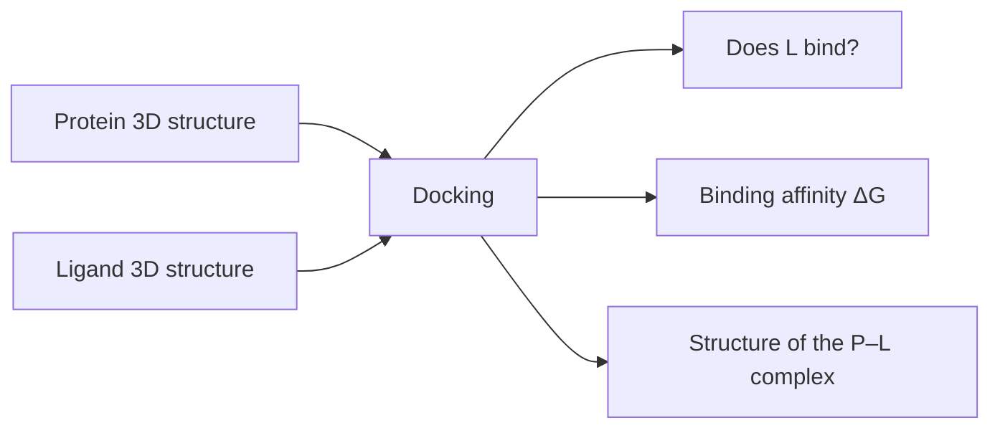
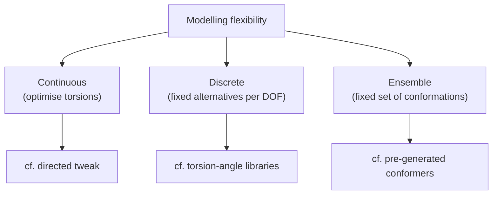

# Docking

**Given** the 3D structure of a target protein P and the (3D) structure of a second
molecule L, **determine**: does L bind to P; if yes, with what binding affinity; and what
does the structure of the P–L complex look like?

## Why it matters

Docking is the structure-based counterpart of everything in lectures 3–4. Where
[[concepts/molecular-superposition]] had to infer the binding site from a set of ligands,
docking has the site. It is also the point where every earlier thread converges: surfaces
(lecture 3), conformations and RMSD fitting (lecture 4), and the thermodynamics of
lecture 1.


*Three questions, and in practice they are answered by two separate machines: a pose search and a scoring function.*

## Taxonomy

```text
BY THE MOLECULES INVOLVED
    macromolecular docking   e.g. protein–protein
    small-molecule docking   e.g. protein–peptide

BY THE TREATMENT OF FLEXIBILITY
    rigid / rigid-body   : both molecules rigid
    (semi-)flexible      : one molecule rigid, the other flexible
    flexible             : both molecules flexible

BY HOW FLEXIBILITY IS MODELLED
    continuous : torsion angles as continuous variables
    discrete   : a fixed set of alternatives per degree of freedom
    ensemble   : a fixed set of conformations
```

| Axis | Options |
|---|---|
| Molecules | macromolecular / small-molecule |
| Flexibility considered | rigid / semi-flexible / flexible |
| Flexibility modelled | continuous / discrete / ensemble |


*The same three options appeared for pharmacophore matching — the flexibility problem is representation-independent.*

All the algorithms treated in this lecture — [[concepts/dock-algorithm]],
[[concepts/kuhl-algorithm]], [[concepts/clix-algorithm]],
[[concepts/geometric-hashing-docking]] — are **rigid-body** methods. They solve the pose
problem for a fixed conformer; flexibility is then handled by repeating the search over an
ensemble.

## Caveats

- Rigid-body docking assumes the bioactive conformer is among the inputs —
  [[concepts/protein-flexibility]] shows the protein moves too (induced fit).
- Pose prediction and affinity prediction are different difficulties: a method can place a
  ligand correctly and rank it badly, because the ranking depends on
  [[concepts/scoring-functions]].

## See also

- [[concepts/scoring-functions]]
- [[concepts/dock-algorithm]]
- [[concepts/kuhl-algorithm]]
- [[concepts/clix-algorithm]]
- [[concepts/geometric-hashing-docking]]
- [[concepts/protein-ligand-binding]]
- [[concepts/virtual-screening]]

## Sources

- [[sources/ciw-05-pharmacophores-qsar-and-docking]] (p. 25)
