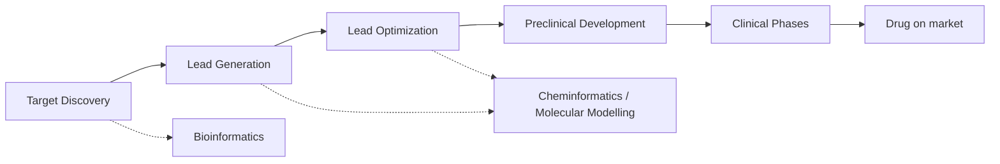
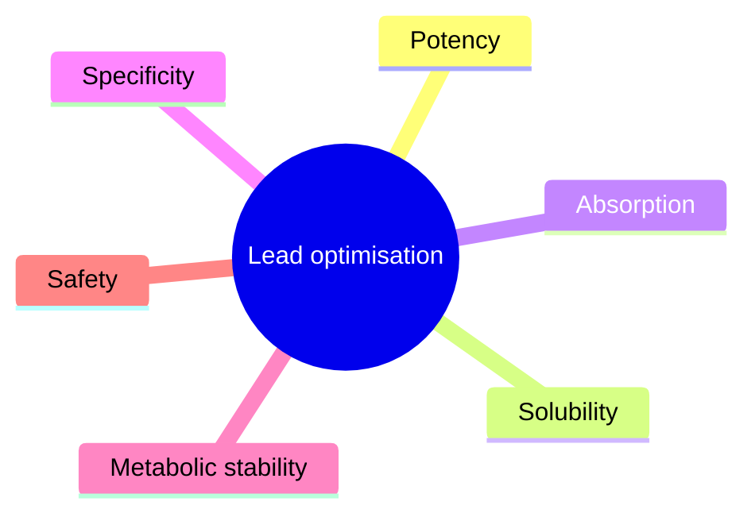
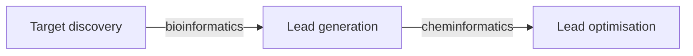

# Drug Discovery Pipeline

The staged process that turns a biological hypothesis into an approved drug, split into a
**preclinical** phase (find and optimise a molecule) and a **clinical** phase (prove it is
safe and effective in humans).

## Why it matters

Every cheminformatics method in this module attaches to exactly one stage of this pipeline.
Knowing the stage tells you what data exists, what the decision is, and what error is tolerable.

## Stages

*Computers support target discovery through bioinformatics, and lead generation/optimisation through cheminformatics.*

**Preclinical**
1. Search for a bioactive compound → **hit**
2. Development of a lead structure → **lead** (Leitstruktur)
3. Verification of the mechanism of action (Wirkmechanismus)
4. Testing of toxicity / ADME
5. Testing cascade: receptors/proteins → cells → organs → animals

**Clinical**
- Phase 1 — healthy subjects (safety, tolerance)
- Phase 2 — selected patients
- Phase 3 — patient groups → approval as a medicine
- Phase 4 — post-approval clinical monitoring

## Key definitions

- **Hit** — any compound that has binding activity to the biological target.
- **Lead / Leitstruktur** — a compound with pharmacological activity that still needs to be
  optimised; a chemical substance selected as the starting point for developing a drug
  candidate, showing a desired in-vitro effect.

## Cheminformatics contributions

- Compound management
- Physico-chemical property prediction
- Screening library design
- Virtual screening → [[concepts/virtual-screening]]
- Screening data analysis
- ADME/TOX prediction → [[concepts/admet]]
- Lead-series activity prediction → QSAR

## Optimisation is multi-objective

A lead must be improved along several axes at once, and they conflict:

*Six competing objectives; improving one (e.g. potency via larger lipophilic surface) usually degrades another (solubility).*

- **Potency** — strength of effect of a pharmacon as a function of dose or concentration.
- **Solubility** — Löslichkeit.
- **Absorption** — passage of the active ingredient from the digestive tract (stomach/intestine)
  into the bloodstream.
- **Specificity** — the drug triggers one defined effect, i.e. no side effects.
- **Metabolic stability** — susceptibility of compounds to biotransformation; relevant when
  selecting drugs with suitable properties.
- **Safety** — no toxic or other adverse effects.

## GCI boundary between bioinformatics and cheminformatics

GCI places **target discovery** in bioinformatics and **lead generation / lead optimisation** in cheminformatics. The hand-off is a change in object: genes, proteins and targets upstream; molecules, properties and transformations downstream.

*GCI uses the pipeline stage to separate bioinformatics from cheminformatics.*

Source: [[sources/gci-01-foundations-of-cheminformatics]] (pp. 1-2).

## See also

- [[concepts/admet]]
- [[concepts/lead-finding-strategies]]
- [[concepts/pharmacokinetics-and-pharmacodynamics]]
- [[concepts/lead-optimization-heuristics]]

## Sources

- [[sources/ciw-01-drug-action-and-molecular-interactions]] (pp. 1–2)
