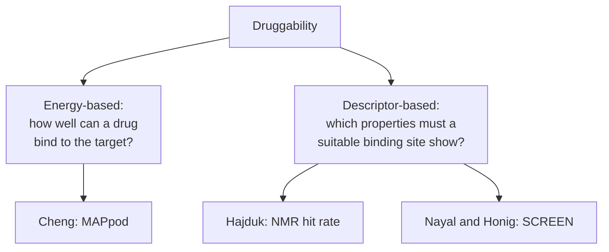

# Druggability

**Protein druggability = the probability that a protein involved in a disease can be
influenced in its activity by a low-molecular-weight drug.**

## Why it matters

Being disease-relevant is not the same as being targetable. Many validated disease proteins
have no pocket a small molecule can bind well. Druggability prediction tries to answer
"is this target worth years of work?" *before* the work starts — the earliest and cheapest
decision point in the [[concepts/drug-discovery-pipeline]].

## From binding site to descriptors

Once a pocket is found ([[concepts/binding-site-detection]]), derive structural descriptors
that correlate with binding behaviour:

```text
DESCRIPTORS OF THE ACTIVE SITE
    volume
    interaction pattern
    which atoms belong to the active site
        ↓
    → protein FUNCTION prediction
    → protein FAMILY clustering
    → protein DRUGGABILITY prediction
```

- **Function prediction** — identifying the characteristic properties of a protein's active
  site gives information about its function.
- **Comparison of active sites** — split proteins into classes with clustering methods, cf.
  [[concepts/clustering-of-molecules]].
- With suitable calibration, machine-learning methods annotate protein functions on the
  basis of these descriptors.
- **Druggability prediction** — classify a target by membership of a protein class regarded
  as druggable.

## Two approaches


*One approach computes the best achievable affinity; the other learns which pockets have historically been druggable.*

### Cheng — energy-based

```text
"How well can a drug molecule bind to the target protein?"
    → maximal affinity on ligand binding

  description of the energies occurring on ligand binding
  based on the protein structure
  quantitative estimate of the maximal binding affinity
      achievable by a drug molecule
  binding energy via discrete energy terms important for binding,
      combined with parameters for 'drug likeness'

  MAP_POD = maximal affinity predicted for a
            passively absorbed oral drug

      ΔG_MAPpod = ΔG_target desolvation
                + ΔG_ligand desolvation
                + ΔG_contact
```

The three terms are exactly the physics of [[concepts/desolvation-and-water]] plus contact:
both partners must pay to shed their water shells, and the contact term is what they earn
back.

### Hajduk — descriptor-based, experimental

```text
  NMR-based fragment screening against a large molecule database
  identify the number and type of the molecule hits
  DRUGGABLE = target proteins that lead to MANY, DIVERSE hits
  important factors: charge, hydrophobicity and shape
  correlation between hit rate and highly affine drug molecules

  DRUGGABILITY SCORE = predicted log hit-rate
                       from geometric pocket parameters (QSAR)
```

The construction is a [[concepts/qsar]] model with an unusual dependent variable: not
affinity, but the *hit rate* of a fragment screen. See
[[concepts/fragment-based-drug-design]].

### Nayal and Honig — SCREEN

```text
SCREEN = Surface Cavity Recognition and Evaluation

  binding pocket: geometry-based, spheres
  description of the surface via shape and geometry parameters
      → FEATURE VECTOR
  machine-learning method: RANDOM FOREST

RESULTS
  - pocket volume does NOT correlate with ligand volume
    (the drug binds to a LARGE pocket)
  - ligand binding sites are usually the largest,
    very hydrophobic and geometrically very complex pockets
    on the surface

PROPERTIES OF DRUG-BINDING POCKETS:
    LARGE, DEEP, RIGID, CURVED
```

The non-correlation of pocket and ligand volume is the most useful single fact here: drugs
do not fill their pockets. That undermines any druggability heuristic based on shape
complementarity alone, and it explains why the [[concepts/hydrophobic-effect]] dominates —
a large hydrophobic surface buried by a small ligand is still a large entropic gain.

## Caveats

- Cheng's estimate is an *upper bound* on affinity; it says nothing about selectivity,
  [[concepts/admet]] or synthesisability.
- Hajduk's method requires wet-lab NMR screening and a lot of protein; it is a measurement
  dressed as a prediction.
- SCREEN is trained on historically successful targets, so it reproduces the bias of what
  the field has already tried — a novel pocket class would score badly.
- "Druggable" here means *druggable by an orally absorbed small molecule*; biologics change
  the question entirely.

## See also

- [[concepts/binding-site-detection]]
- [[concepts/fragment-based-drug-design]]
- [[concepts/drug-discovery-pipeline]]
- [[concepts/hydrophobic-effect]]
- [[concepts/desolvation-and-water]]
- [[concepts/qsar]]

## Sources

- [[sources/ciw-06-flexible-docking-binding-sites-and-fragment-spaces]] (pp. 14–16)
