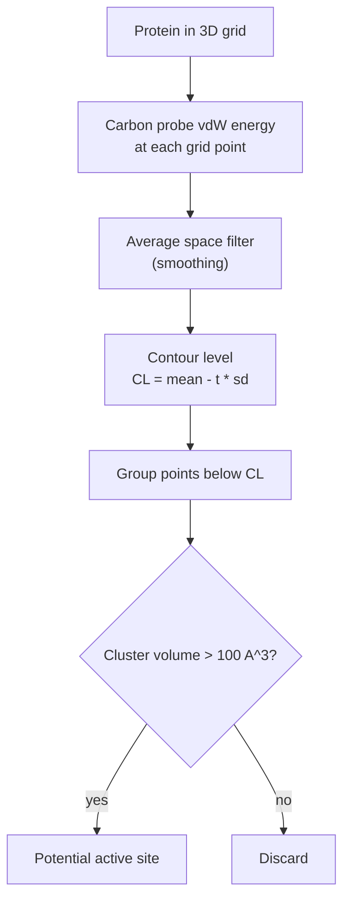

# DrugSite

Energy-based [[concepts/binding-site-detection|binding-site detection]]: place the protein
in a grid, compute the van der Waals interaction of a carbon probe at every grid point, and
report the low-energy clusters as pockets.

## Why it matters

Geometry-based methods ask whether a region is *concave*. DrugSite asks whether it is
*attractive*. These are not the same question: a concave region lined with the wrong atoms
binds nothing, and the energy criterion filters those out automatically.

## Mechanics

```text
ALGORITHM DrugSite
INPUT : protein 3D structure
OUTPUT: position, volume and shape of potential active sites

1. place the protein in a 3D grid
2. FOR each grid point i:
       determine the vdW interaction of a probe sphere (CARBON PROBE)
       with all neighbouring protein atoms:

           P_i = Σ_j^N ( A_j·C / r_ij^12  −  B_j·C / r_ij^6 )

3. AVERAGE SPACE FILTER:
       the value of each grid point becomes the mean of all
       surrounding grid points
       ⇒ smoothing, brings out regions of higher density
4. group all grid points whose energy lies BELOW a computed contour level:

           CL = mean − threshold × standard deviation

5. all clusters with a volume > 100 ų are potential active sites
```

The energy expression is the 12–6 [[concepts/lennard-jones-potential]] summed over
neighbouring protein atoms.


*Smoothing before thresholding is essential: raw per-point energies are dominated by isolated deep wells next to individual atoms.*

The average space filter is the conceptual heart. A single grid point very close to one
atom has a huge favourable term but is not a pocket; averaging rewards *regions* of
sustained attraction, which is what a binding site actually is.

Reported accuracy in the notes: **8 % (1)** — strikingly poor compared to the geometric
methods, consistent with the lecture's remark that energy-based prediction depends heavily
on force-field parameterisation.

## Caveats

- Depends on the scoring function and the force-field parameters — the characteristic
  weakness of the energy-based family.
- A carbon probe is apolar; polar or charged sub-pockets are under-weighted.
- The `C` factor in the energy sum and the `threshold` in the contour level are not defined
  in the notes.
- Still grid-based, so the grid-width and orientation sensitivities of
  [[concepts/ligsite-and-pocket]] apply as well.

## See also

- [[concepts/binding-site-detection]]
- [[concepts/lennard-jones-potential]]
- [[concepts/ligsite-and-pocket]]
- [[concepts/comfa]]
- [[concepts/scoring-functions]]

## Sources

- [[sources/ciw-06-flexible-docking-binding-sites-and-fragment-spaces]] (p. 11)
