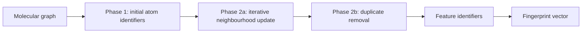

# ECFP and FCFP Fingerprints

ECFP and FCFP are circular fingerprints that describe molecules by hashed identifiers for atom-centred neighbourhood features.

## Why it matters

They are a Morgan-style [[concepts/molecular-fingerprints]] family used for screening, structure-activity analysis and library design. ECFP emphasises atom-level structural detail; FCFP uses more pharmacophoric initial atom descriptions.

## How it works

GCI part 4 gives three phases: initial assignment, iterative updating and duplicate removal.


*ECFP grows circular environments around each atom, hashes them and keeps one copy of duplicate substructures.*

```text
ALGORITHM ECFP(M, radius r)
  INPUT : molecular graph M and maximum radius r
  OUTPUT: set or vector of feature identifiers

  for each atom a in M:
      id[a,0] <- initialECFPIdentifier(a)
      atomSet[a,0] <- {a}
      bondSet[a,0] <- {}
  features <- all radius-0 atom features

  for k in 1..r:
      for each atom a:
          neighbours <- []
          for each bond a-b:
              append (bondOrder(a,b), id[b,k-1]) to neighbours
          vector <- [id[a,k-1]] + sort(neighbours)
          if stereochemistry is defined at this radius:
              append stereo flag to vector
          id[a,k] <- hash(vector)
          atomSet[a,k] <- atoms in neighbourhood of radius k around a
          bondSet[a,k] <- bonds in neighbourhood of radius k around a
          add feature(id[a,k], atomSet[a,k], bondSet[a,k], k)
      features <- RemoveDuplicateCircularFeatures(features)
  return identifiers(features)
```

```text
PROCEDURE RemoveDuplicateCircularFeatures(features)
  INPUT : generated circular features with atom sets and bond sets
  OUTPUT: duplicate-free feature set

  keep <- empty map from (atomSet, bondSet) to feature
  for each feature f:
      key <- (f.atomSet, f.bondSet)
      if key not in keep:
          keep[key] <- f
      else:
          keep[key] <- choose canonical representative of keep[key] and f
  return values(keep)
```

## Practical notes

- ECFP initial identifiers in the notes include heavy-atom bonding information, charge, element, hydrogen count, isotope, valence and cyclic/ring flags.
- FCFP changes the initial description to pharmacophoric properties.
- The feature vector stores all generated feature identifiers; identifiers are integers describing features.
- Features are commonly folded or hashed into a fixed-size fingerprint for database comparison.

## Limitations / caveats

- Different circular centres can generate the same substructure; duplicate removal is required.
- Hashing and folding can collide.
- The source gives the phases and examples, but not a toolkit-exact duplicate retention rule.

## See also

- [[concepts/molecular-fingerprints]]
- [[concepts/morgan-canonicalization]]
- [[concepts/molecular-similarity]]
- [[concepts/similarity-and-distance-measures]]

## Sources

- [[sources/gci-04-molecular-glues-descriptors-fingerprints-and-similarity]] (pp. 9, 11-12)
