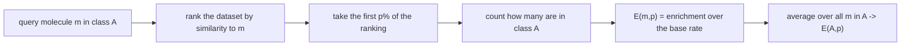

# Enrichment Factor

A measure for **comparing similarity measures**: how much more of a known active class does
a similarity ranking pull into the top `p %` of a dataset than chance would?

## Setup

```text
input : a dataset with n molecules, of which |A| belong to class A
        sort the dataset by similarity to a molecule m ∈ A
```

## Definition

```text
                % molecules of m's class in the first p% of data
E(m, p)  =  ─────────────────────────────────────────────────────
                    % molecules of m's class in the data

                1
E(A, p)  =  ───────  Σ_{m ∈ A}  E(m, p)          # average over the class
               |A|
```

`E = 1` means the ranking is no better than random. `E = 10` at `p = 1 %` means the top
percent of the list is ten times as rich in actives as the whole database.


*The enrichment factor is a ratio of two percentages: the class share in the top slice divided by the class share overall.*

## %MAEF

```text
%MAEF = % of the maximal achievable enrichment factor
```

The maximum achievable enrichment is bounded: if the class is larger than the top `p %` of
the dataset, not all of its members can fit in the slice. Reporting the *fraction of the
achievable maximum* makes results comparable across class sizes and values of `p`.

## Why it matters

This is the standard way to decide whether a new descriptor is worth using: run a
retrospective [[concepts/virtual-screening]] experiment on a dataset with known actives and
compare enrichment against the incumbent. The lecture's worked example compares
**2D fingerprints against split-search** ([[concepts/feature-tree-comparison]]).

## Caveats

- Enrichment depends strongly on `p`; a method can win at 1 % and lose at 10 %.
- It measures only the head of the ranking, which is what matters in practice but says
  nothing about the rest — [[concepts/roc-curves-and-auc]] measures the whole ranking.
- The result depends on the composition of the benchmark set; actives that are trivially
  similar to each other inflate every method's score.

## See also

- [[concepts/roc-curves-and-auc]]
- [[concepts/virtual-screening]]
- [[concepts/feature-tree-comparison]]
- [[concepts/reduced-graphs]]

## Sources

- [[sources/ciw-04-descriptor-evaluation-clustering-and-superposition]] (p. 1)
