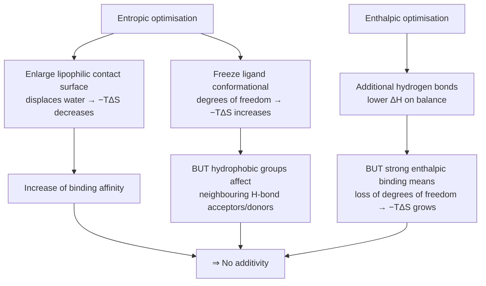

# Enthalpy–Entropy Compensation

Any change that improves the enthalpic term of binding tends to worsen the entropic term,
and vice versa — which is why binding affinity is **not additive**.

## The central statement

> There is **no correlation** of the affinity with the number of hydrogen bonds or with the
> size of the lipophilic contact surface alone.

## The two optimisation routes and how they fight each other


*Each optimisation route creates its own counter-effect.*

**Entropic optimisation**
- Enlarging the lipophilic contact surface leads to a **decrease of −TΔS** (displacing water
  has a positive entropic effect).
- Freezing conformational degrees of freedom of the ligand leads to an **increase of −TΔS**.
- ⇒ increase of the binding affinity
- *but*: hydrophobic groups influence neighbouring hydrogen-bond acceptors/donors.

**Enthalpic optimisation**
- Additional hydrogen bonds lead, on balance, to a **lowering of ΔH**.
- *but*: strong enthalpic binding also means the **loss of degrees of freedom**, which leads
  to an **increase of −TΔS**.

⇒ **No additivity.**

## Energy contributions of the binding event

| Event | Enthalpic part | Entropic part |
|---|---|---|
| Stripping the hydration shell (ligand & protein) | breaking of hydrogen bonds | degrees of freedom of the H₂O molecules |
| Adaptation of ligand and protein conformation (**induced fit**) | conformational energy | freezing of internal degrees of freedom |
| Formation of reversible, weak, short-range interactions | salt bridges, H-bonds, cation-π interactions | — |

```text
ALGORITHM AffinityChange(modification m, complex C)
  INPUT : a proposed chemical modification
  OUTPUT: predicted ΔΔG — and why a naive estimate fails

  ΔΔH <- enthalpy gained from new contacts
        − enthalpy cost of desolvating the new groups
  ΔΔS <- entropy gained from released water
        − entropy lost by freezing new degrees of freedom
  ΔΔG <- ΔΔH − T · ΔΔS
  # the two terms largely cancel ⇒ small, hard-to-predict net effect
```

## See also

- [[concepts/binding-thermodynamics]]
- [[concepts/desolvation-and-water]]
- [[concepts/hydrophobic-effect]]
- [[concepts/lead-optimization-heuristics]]

## Sources

- [[sources/ciw-01-drug-action-and-molecular-interactions]] (pp. 14, 16)
