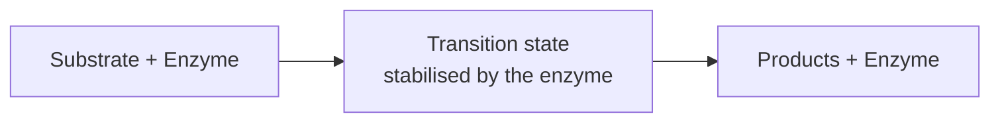

# Enzymes and Receptors

The two dominant classes of drug targets: **enzymes** convert substances, **receptors**
transmit information between cells.

## Biochemical context: two network types

- **Metabolic network (Stoffwechselnetzwerk)** — energy gain for mechanical and chemical work;
  build-up and break-down of the body's own substances.
- **Regulatory network** — transmission, processing and storage of information.

Two verbs distinguish them:
- **Synthesise (bilden)** — substances that are synthesised or transformed in the body.
- **Convert (wandeln)** — conversion of one substance into another, catalysed by enzymes.

## Enzymes

- Conversion of substances — **biocatalysts**.
- **Substrate** — the molecule to be converted; it is stabilised in a **transition state**
  by the enzyme.


*The enzyme lowers the activation barrier by stabilising the transition state.*

### Inhibitors

An **inhibitor** reduces the catalytic activity.

| Type | Mechanism |
|---|---|
| Competitive | binds in the active site and displaces the substrate |
| Allosteric | binds at a different site and induces conformational changes of the protein |
| Reversible / irreversible | orthogonal axis: whether the inhibitor can dissociate again |

```text
ALGORITHM ClassifyInhibitor(inhibitor, enzyme)
  INPUT : binding-site location, dissociation behaviour
  OUTPUT: mechanism label

  if bindingSite(inhibitor) == activeSite(enzyme):
      mechanism <- "competitive"          # displaces substrate
  else:
      mechanism <- "allosteric"           # conformational change
  if dissociates(inhibitor):
      return mechanism + ", reversible"
  else:
      return mechanism + ", irreversible" # e.g. covalent bond
```

## Receptors

- Information exchange between cells, hormone-controlled gene expression, control of the
  concentration gradient of substances.
- Frequently **membrane-bound**.

## See also

- [[concepts/protein-ligand-binding]]
- [[concepts/binding-thermodynamics]]
- [[concepts/admet]]

## Sources

- [[sources/ciw-01-drug-action-and-molecular-interactions]] (pp. 5, 8)
