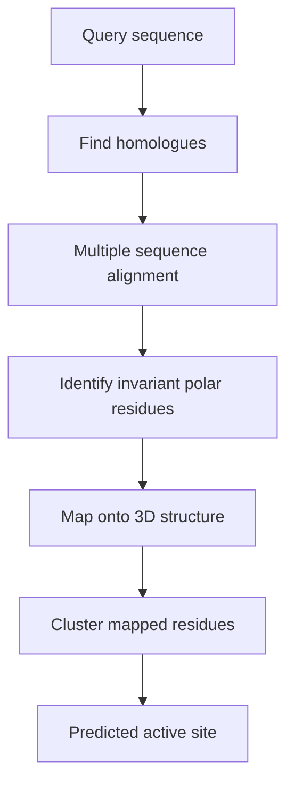

# Evolution-based site prediction

Finding the active site via **conserved residues**: amino acids important for a protein's
function are conserved during evolution, so the positions that never change across
homologues mark the functional site.

## Why it matters

This is the only method family in the lecture that uses information *outside* the structure
itself. Geometry and energy describe what the protein looks like now; conservation records
what selection has refused to let change. Where the two agree, confidence is high.

## Mechanics (after Aloy)

```text
ALGORITHM Aloy
INPUT : protein sequence + structure
OUTPUT: predicted active site

  amino acids important for the protein's function
      are conserved during evolution
  find homologous sequences with the help of a
      MULTIPLE SEQUENCE ALIGNMENT (MSA)
  identify the INVARIANT POLAR residues
  map the residues onto the protein structure
  cluster the mapped residues
  → predict the active site
```


*Conservation is computed in sequence space, then projected into structure space, where clustering restores the spatial notion of a site.*

The restriction to **polar** residues is deliberate: polar residues are the ones that form
the specific directional contacts of [[concepts/hydrogen-bond]] and
[[concepts/ionic-interactions-and-metal-complexation]], and they are also the ones whose
conservation is most informative (hydrophobic positions are often conserved merely for
folding reasons).

## Caveats

- **Depends on the number of known related sequences.** For an orphan protein with no
  detectable homologues the method yields nothing.
- Conservation marks *functional* sites, which for a non-enzyme may be a protein–protein
  interface rather than a small-molecule pocket — see
  [[concepts/protein-protein-docking]].
- Alignment errors propagate directly into the prediction.

## See also

- [[concepts/binding-site-detection]]
- [[concepts/binding-site-prediction-evaluation]]
- [[concepts/enzymes-and-receptors]]
- [[concepts/druggability]]

## Sources

- [[sources/ciw-06-flexible-docking-binding-sites-and-fragment-spaces]] (p. 12)
