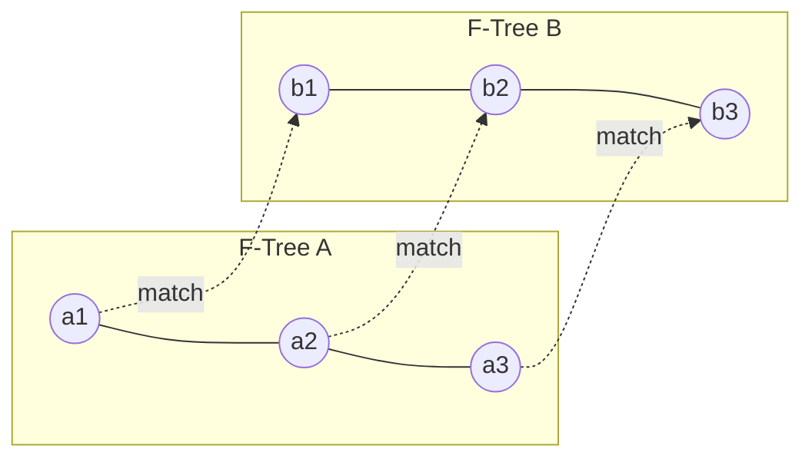
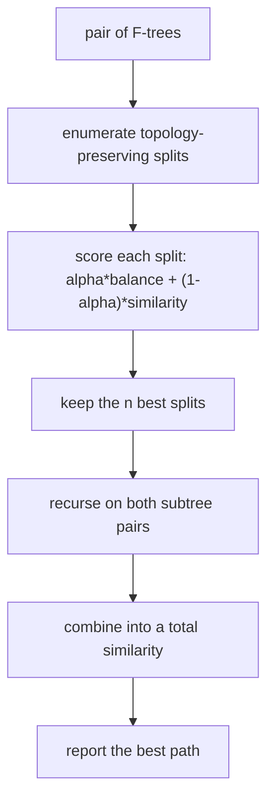

# Feature Tree Comparison (Split-Search and Match-Search)

Computing a **topology-preserving matching** `M` between the subtrees of two feature trees
([[concepts/feature-trees]]), and scoring it.

## Topology-preserving matching

Conditions on a matching `M` between subtrees of two F-trees:

- every node occurs in **at most one** match;
- let `P` be the set of paths whose intermediate nodes belong to no match. For any two
  matches `m = (a,b)`, `m' = (a',b')`:

```text
∃ path in P between nodes from a and a'   ⟺   ∃ path in P between nodes from b and b'
```

- subtrees are **bounded in size**;
- matches are **balanced** up to a factor `f`:  `1/f < a/b < f`.


*Topology preservation: the relative arrangement of the matched subtrees must be the same in both trees — crossing assignments are forbidden.*

## Scoring

```text
similarity of a single match (a,b):
    sim(m) = s · f_steric(a,b) + (1 − s) · f_chemistry(a,b)

similarity of two F-trees A and B under matching M:
                Σ_{m ∈ M} size(m) · sim(m)
    S_M(A,B) = ─────────────────────────────
                    size(A) + size(B)
```

Weighting each match by `size(m)` means large matched fragments dominate the score, which is
chemically what you want: agreeing on a shared ring system counts more than agreeing on a
single methyl group.

## Algorithm 1: Split-Search

**Definition.** Given two F-trees, a **split** is a pair of directed edges, one in each
F-tree. A split describes the decomposition into two subtrees and the assignment of those
subtrees.

```text
ALGORITHM Split-Search(A, B)        # divide & conquer
  for all topology-preserving splits:
      evaluate the splits by the similarity of the assigned subtrees
      select the n best splits
  for all selected splits:
      recursively compute the similarity of the subtrees
      merge into a total similarity value
  return the value of the best path
```

**Split score:**

```text
score(S) = α · ( bal(a₁,a₂) + bal(b₁,b₂) ) / 2
         + (1 − α) · ( sim(a₁,b₁) + sim(a₂,b₂) )
```

`α` is the **balance-versus-similarity factor**: it trades a well-balanced decomposition
(which keeps the recursion shallow) against a chemically sensible one.


*Divide and conquer: cut both trees at a matched edge pair, then solve the two halves independently.*

## Algorithm 2: Match-Search

⚠️ **Problem with split-search:** it does **not** produce non-terminal partial matches — it
always cuts all the way through both trees, so a match confined to the interior of the
molecules cannot be expressed.

```text
ALGORITHM Match-Search(A, B)
  1. set an initial split
  2. compare subtrees with root
  3. select the best extension match
  4. compute the similarity of all subtree combinations
  5. determine the subtree combination with the highest similarity value
```

Steps 3–5 are realised by **dynamic programming** over a matrix of subtree pairs.

**Match score:**

```text
score(m) = α · sim(a₁, a₂) + (1 − α) · sim(ν₁, ν₂)
```

### Sub-algorithms of match-search

| Sub-problem | Method |
|---|---|
| Determining the order in which the matrix is computed | traversal order over the tree edges (each edge is processed in both directions) |
| Evaluating extension matches | `score(m)` above |
| Computing the assignment of subtrees | **maximum-weight bipartite matching** |

The bipartite matching step is what makes the extension step optimal rather than greedy:
having scored every candidate pair of subtrees, the best global assignment is chosen in one
go.

## Caveats

- Both algorithms are heuristics — split-search keeps only the `n` best splits, so the
  reported similarity is a lower bound on the optimum.
- The score depends on `α` and on the steric/chemistry weight `s`; similarity values from
  different parameter settings are not comparable.

## See also

- [[concepts/feature-trees]]
- [[concepts/reduced-graphs]]
- [[concepts/virtual-screening]]
- [[exercises/ciw-e5-feature-trees]]

## Sources

- [[sources/ciw-03-pattern-mining-diagrams-surfaces-and-reduced-graphs]] (pp. 23–26)
