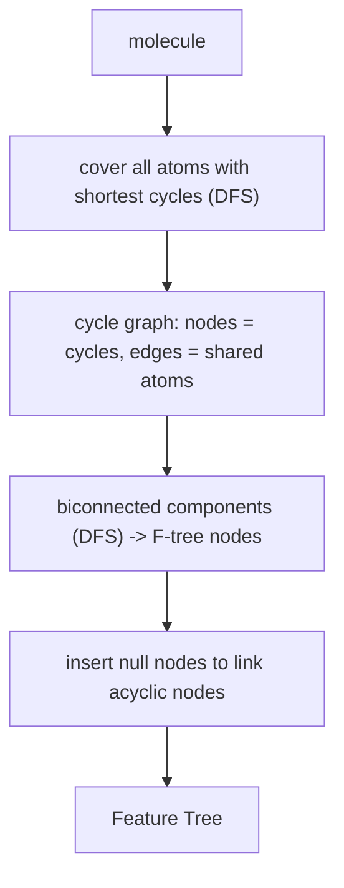

# Feature Trees

A representation of a molecule (Rarey) as a **node-labelled tree**, where each node is a
building block of the molecule and its label carries the steric and chemical properties of
that block.

## Definition

| Element | Meaning |
|---|---|
| **Node** | a building block (Baugruppe) of the molecule |
| **Edge** | according to the molecular graph |
| **Label** | steric and chemical properties of the group |

## Pros and cons

| | |
|---|---|
| **+** | better representation of physico-chemical properties |
| **(+)** | takes the molecular structure into account |
| **+** | comparison is based on an assignment of groups |
| **+** | the comparison presupposes **no exact subgraph match** |

That last point is the decisive advantage over [[concepts/subgraph-isomorphism]]: two
molecules that share no common subgraph at all can still receive a high feature-tree
similarity, because the comparison matches *groups with similar properties*, not identical
atoms.

## Three construction steps

```text
1. definition of the building blocks
2. assignment of physico-chemical properties
3. removal of all 3D information
```

Step 3 is deliberate: a feature tree is a **topological** descriptor, so no conformer
generation is required.

## Generation

```text
ALGORITHM BuildFeatureTree(molecule)
  # decomposition of the ring systems
  cover all atoms with the shortest cycles:
      for each atom a:
          determine the cycles of shortest length that contain a      (DFS)
  build a cycle graph:
      nodes : shortest cycles
      edges : between cycles with shared atoms
  determine the biconnected components (DFS); each BCC is one F-tree node
  if necessary, insert null nodes to connect acyclic F-tree nodes
```


*Ring systems are collapsed via a cycle graph, and null nodes keep the result a connected tree.*

Again the lecture-2 toolbox reappears: shortest cycles
([[concepts/sssr-and-minimal-cycle-basis]]) and biconnected components
([[concepts/biconnected-components-and-acyclic-bonds]]).

## Node labels

Boundary conditions imposed by the comparison algorithms — three functions must exist:

| Function | Signature |
|---|---|
| **Generator** `g` | molecule fragment → label |
| **Compare** `f` | label × label → `[0,1]` |
| **Combine** `c` | label × label → label |

`combine` is needed because the matching may map one node of tree A onto several nodes of
tree B; those must be merged into a single effective label first.

### Concrete labels

**Steric properties:** `#atoms` → approximates the VdW volume (sphere volume), cf.
[[concepts/lennard-jones-potential]].

**Physico-chemical properties:**

```text
atom-type profile        A = (a₁, …),  a₁ = #atoms of type 1
interaction profile      I = (i₁, …),  i₁ = #interaction partners of type 1
```

**Compare function:**

```text
              Σ_i min(a_i, b_i)
f(A, B) =  ─────────────────────
            Σ_i (a_i + b_i) / 2
```

This is a soft, count-based overlap: identical profiles give 1, disjoint profiles give 0,
and partial overlap is graded rather than all-or-nothing.

## See also

- [[concepts/feature-tree-comparison]]
- [[concepts/reduced-graphs]]
- [[concepts/biconnected-components-and-acyclic-bonds]]
- [[concepts/sssr-and-minimal-cycle-basis]]
- [[exercises/ciw-e5-feature-trees]]

## Sources

- [[sources/ciw-03-pattern-mining-diagrams-surfaces-and-reduced-graphs]] (pp. 22–23)
