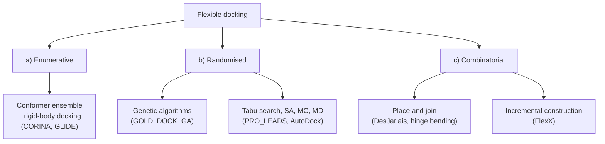

# Flexible docking

Docking that takes the **conformation space of the ligand** — and possibly of the protein —
into account, instead of treating both as rigid bodies.

## Why it matters

Rigid-body docking ([[concepts/dock-algorithm]], [[concepts/clix-algorithm]]) asks only
*where* the ligand goes. A drug-like ligand with 5–10 rotatable bonds has thousands of
relevant conformers, and binding selects one of them — usually not the global minimum in
solution (see [[concepts/molecular-conformation]]). Ignoring this means docking the wrong
molecule.

## The three approaches

```text
GOAL: consider the conformation space of the ligand, possibly also of the protein

a) ENUMERATIVE
      enumerate ligand conformations, then use rigid-body docking
b) RANDOMISED
      genetic algorithms, Monte Carlo, simulated annealing
c) COMBINATORIAL
      based on a combinatorial view of the conformation space
      → place & join
      → incremental construction
```


*The three families differ in whether conformers are precomputed, sampled stochastically, or built up in place.*

The trade-off runs along one axis: **when is the conformation decided?**

| Family | Conformation decided | Consequence |
|---|---|---|
| enumerative | before docking | decoupled from the pocket; the ensemble may miss the bound conformer |
| randomised | during search, stochastically | no completeness guarantee; results vary between runs |
| combinatorial | during construction, guided by the pocket | conformation and placement co-determine each other |

The combinatorial family is the one the lecture develops in detail, because deciding
conformation *inside* the pocket means the pocket prunes the conformation space for free —
the same insight that made [[concepts/flexible-superposition]] (FlexS) work.

## Caveats

- Protein flexibility ([[concepts/protein-flexibility]]) is usually still neglected, or
  approximated by soft potentials or side-chain optimisation only.
- More sampling does not help if the [[concepts/scoring-functions|scoring function]] cannot
  tell good poses from bad ones; sampling and scoring failures are often confused.

## See also

- [[concepts/docking]]
- [[concepts/genetic-algorithm-docking]]
- [[concepts/randomised-docking]]
- [[concepts/place-and-join]]
- [[concepts/incremental-construction-docking]]
- [[concepts/conformation-generation]]

## Sources

- [[sources/ciw-06-flexible-docking-binding-sites-and-fragment-spaces]] (p. 4)
