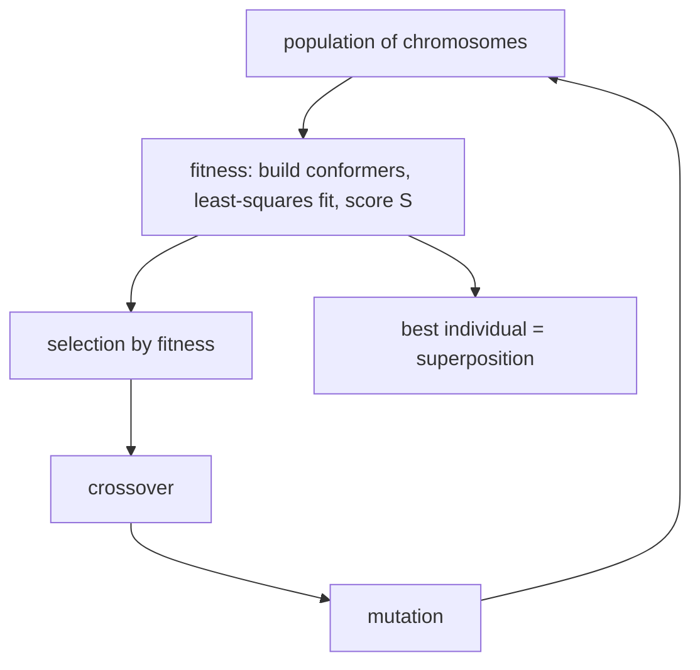
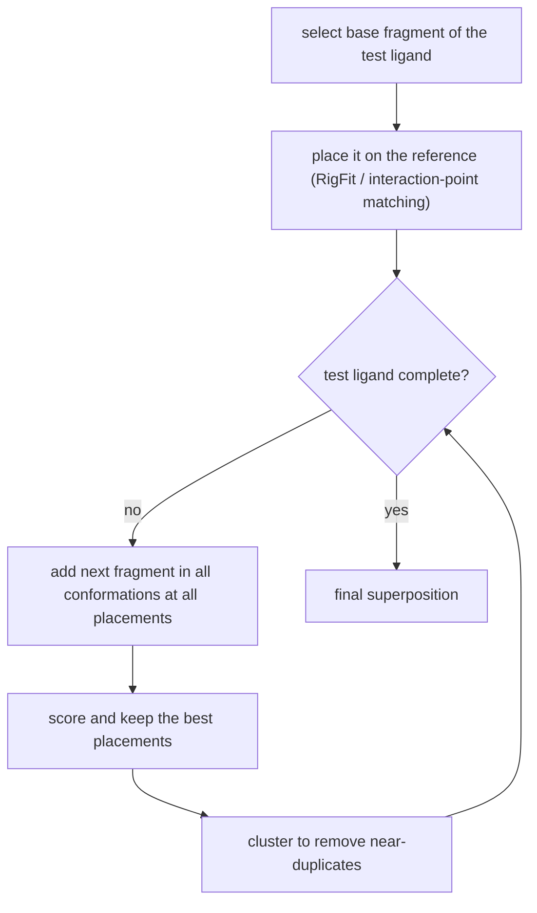

# Flexible Superposition (GASP and FlexS)

[[concepts/molecular-superposition]] in which the molecules may also **change conformation**.

## Degrees of freedom

```text
transformation (t, R)  +  conformations of the molecules

semi-flexible : one molecule is rigid, one is flexible
flexible      : both molecules can change conformation
```

> Flexible superposition is a **mixed discrete/numerical optimisation problem**;
> **all algorithms are heuristic.**

The mixture is the difficulty: the pose `(t, R)` is continuous, but the choice of conformer
and of which groups match which is discrete, and the two cannot be optimised independently.

---

## GASP — genetic algorithm

| GA concept | Meaning here |
|---|---|
| solutions | individuals |
| objective function | fitness |
| representation | chromosome |
| modification | genetic operators |

### Chromosome (representation of the molecules)

```text
N   conformation strings, each one byte per torsion angle        (gray-coded angles)
N−1 matching strings (integer): injective assignment of interaction groups
    to one selected "base molecule" with L interaction groups

M_i(k) = l  :  the k-th interaction group of molecule i forms an interaction
               with the protein analogous to the l-th interaction group of the base molecule
```

### Fitness function (evaluation of a chromosome C)

```text
1. build the molecular conformations according to C
2. superpose the assigned interaction groups        (least-squares fit)
3. similarity function:

       S = k₁·E_conf + k₂·E_vol + k₃·E_match

   E_conf  : conformational energy
   E_vol   : volume overlap
   E_match : similarity score (H-acceptor / -donor / aromatic rings)
```

### Genetic operators

A randomly chosen string is modified.

| Operator | Conformation string | Matching string |
|---|---|---|
| **Crossover** | one-point crossover, randomly chosen | two-point crossover, then removal of duplicate assignments (injectivity) |
| **Mutation** | mutation probability `1/L` (`L` = number of bits) | a randomly selected integer is changed to a randomly determined value |

Other parameters: **selection pressure** (probability that parents with the best fitness
values are chosen), **crossover/mutation rates**, and an **island model** (independent
subpopulations are optimised separately).


*A standard genetic algorithm; the chemistry sits entirely inside the chromosome encoding and the fitness function.*

---

## FlexS — incremental construction

- **pairwise** superposition, **semi-flexible**.
- **Interaction model:** not the interaction groups of the molecules themselves, but the
  **possible interaction counter-groups** must be superposed.
  - *Interaction surface*: the region on which a counter-group must be placed.
  - Two molecules can make an interaction with the protein at the same place exactly when
    **their interaction surfaces intersect**.

This is a subtle and important shift: matching the ligands' own donor atoms would demand
that they coincide exactly, whereas matching the *regions where the protein's partner must
sit* correctly allows two chemically different groups to play the same role.

### Scoring

```text
S = k₁·E_match + k₂·E_vol + k₃·E_gauss

E_match : assigned interaction groups, taking geometric deviations into account
E_vol   : volume overlap
E_gauss : overlap of Gaussian functions — hydrophobicity, partial charges,
          H-bond capability                 (see [[concepts/gaussian-molecular-representation]])
```

### Algorithm — incremental construction

```text
1. selection of a base fragment (part of the test ligand)
2. independent placement of the base fragment onto the reference
3. incremental build-up of the test ligand
```

**Base placement:**
- enumeration of the discretised conformational space
- placement with a rigid superposition algorithm (**RigFit**)
- placement via matching of discrete interaction points (similar to the docking program
  FlexX)

**Build-up:**
- starting from the base placement, as long as the test ligand is not complete:
  - add a fragment in all conformations at all placements
  - evaluate and select the placements with a high score
  - **clustering** to avoid very similar placements
    ([[concepts/clustering-of-molecules]])


*A beam search over partial placements: grow, score, prune, repeat.*

## See also

- [[concepts/molecular-superposition]]
- [[concepts/seal-algorithm]]
- [[concepts/gaussian-molecular-representation]]
- [[concepts/conformation-generation]]
- [[concepts/clustering-of-molecules]]
- [[concepts/protein-flexibility]]

## Sources

- [[sources/ciw-04-descriptor-evaluation-clustering-and-superposition]] (pp. 22–24)
