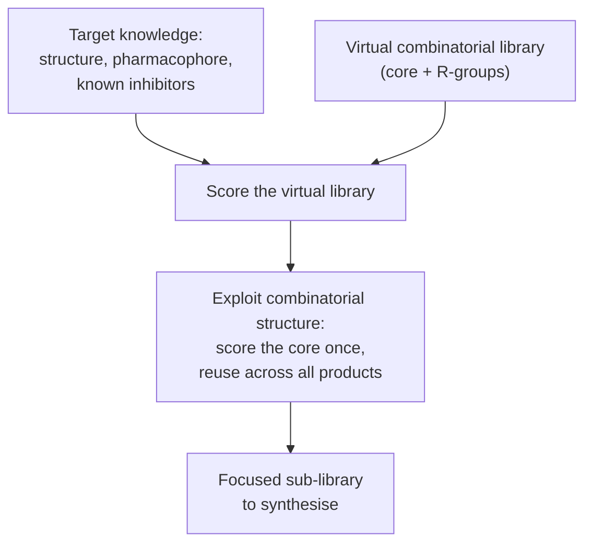

# Focused combinatorial libraries

Combinatorial libraries designed for one **specific target** rather than for general
diversity.

## Why it matters

A diverse library ([[concepts/combinatorial-libraries]]) spends most of its compounds on
regions of chemistry the target will never accept. If anything at all is known about the
target, that knowledge can be used to bias the library before it is synthesised — trading
breadth for hit rate.

## Additional input

```text
GOAL: design of libraries for a specific target

ADDITIONAL INPUT
    3D structure of the protein
    pharmacophore
    known inhibitors
    substrate
    results of previous screening experiments
```

Each input corresponds to a method already in the wiki: structure →
[[concepts/docking]]; pharmacophore → [[concepts/pharmacophore-matching]]; known
inhibitors → similarity search and [[concepts/qsar]].

## Combinatorial docking / library design

```text
apply DOCKING / PHARMACOPHORE MAPPING / SIMILARITY SEARCH
    to combinatorial libraries

ACCELERATION of the search procedures by exploiting the
    COMBINATORIAL STRUCTURE of the virtual library
```


*The key speed-up: products sharing a core share most of the computation, so the cost grows with the number of R-groups, not their product.*

This is the same structural insight as [[concepts/incremental-construction-docking]]: if the
molecules share a common part, dock the common part once. The library's combinatorial
structure is not an obstacle to screening it, it is the reason screening it is affordable.

## Caveats

- Focusing on a target amplifies any error in the target knowledge — a wrong pharmacophore
  hypothesis produces a confidently wrong library.
- Sharing computation across products assumes the shared core binds identically in all of
  them, which R-groups can easily invalidate.
- Narrow libraries are useless for any other project.

## See also

- [[concepts/combinatorial-libraries]]
- [[concepts/virtual-screening]]
- [[concepts/pharmacophore-matching]]
- [[concepts/docking]]
- [[concepts/fragment-spaces]]

## Sources

- [[sources/ciw-06-flexible-docking-binding-sites-and-fragment-spaces]] (p. 18)
