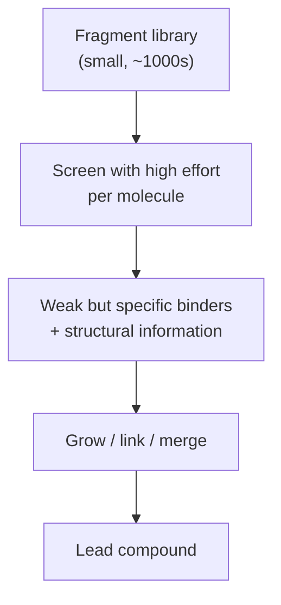

# Fragment-based drug design

Instead of screening drug-sized molecules, first identify **small fragments** that bind
weakly but specifically to the protein, then grow or link them into a lead.

## Why it matters

The counter-intuitive claim is that starting from *worse* binders is better. Three reasons,
all given in the notes:

```text
ADVANTAGES
  - coverage of the chemical space is MUCH GREATER
  - small fragments can be optimised substantially better
  - small fragment collections can be screened with
    HIGHER EFFORT PER MOLECULE
    → weak binders become detectable
```

The coverage argument is combinatorial: the number of molecules grows explosively with size
(see [[concepts/chemical-space]]), so a few thousand fragments sample fragment space far
more densely than a million drug-sized compounds sample drug space.

The optimisability argument is about ligand efficiency: a fragment that binds weakly with
very few atoms is binding *efficiently*, and every atom added afterwards can be chosen to
add affinity — whereas an HTS hit already carries many atoms that contribute nothing and
cannot easily be removed.


*Fragment screening trades affinity for information: each hit comes with a structure showing exactly how it binds.*

## Experimental methods

```text
EXPERIMENTAL
    SAR by NMR
    X-ray crystallography

(+) structural information available for the optimisation
(−) a lot of protein is necessary
```

The structural information is the real product. An HTS hit is a number; a fragment hit is a
binding mode, which feeds directly into [[concepts/lead-optimization-heuristics]] and into
structure-based growing with [[concepts/de-novo-design]] tools.

The same NMR fragment screen also supplies Hajduk's hit-rate-based
[[concepts/druggability]] score — one experiment answering two questions.

## Caveats

- Weak binders (mM affinity) are at the edge of detectability; false positives and
  aggregation artefacts are common.
- Requires large quantities of pure, well-behaved protein and, for X-ray, crystals.
- Growing a fragment does not preserve its binding mode — the optimised molecule may bind
  quite differently.

## See also

- [[concepts/high-throughput-screening]]
- [[concepts/combinatorial-libraries]]
- [[concepts/druggability]]
- [[concepts/de-novo-design]]
- [[concepts/fragment-spaces]]
- [[concepts/lead-finding-strategies]]

## Sources

- [[sources/ciw-06-flexible-docking-binding-sites-and-fragment-spaces]] (p. 18)
