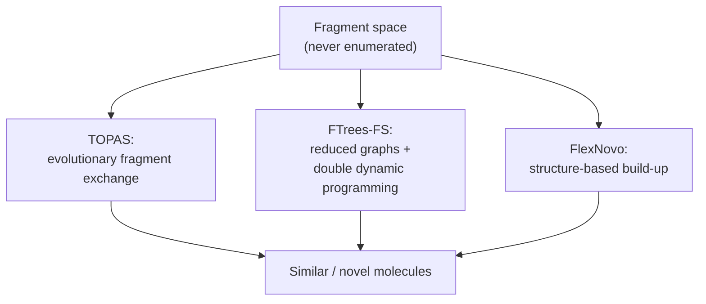

# Fragment space search

Search technologies that find molecules inside a [[concepts/fragment-spaces|fragment space]]
**without enumerating it**.

## Why it matters

A fragment space may contain 10¹² molecules. Enumerating them to run a similarity search is
impossible, so the search algorithm must operate on the fragments and rules directly. Each
of the three methods below solves this differently.


*Three ways to avoid enumeration: sample it, search an abstraction of it, or grow into the pocket.*

## TOPAS

```text
TOPAS
    similarity-based search by successively exchanging
    parts of a molecule in an EVOLUTIONARY OPTIMISATION procedure
    - application of the cut rules
    - exchange of individual fragments
```

Avoids enumeration by **sampling**: the space is explored as a search graph whose moves are
single fragment swaps, scored by similarity to a query. The same evolutionary machinery as
[[concepts/genetic-algorithm-docking]], with fragments in place of torsions.

## FTrees-FS

```text
FTrees-FS
    similarity-based search on the basis of REDUCED GRAPHS
    direct search in a fragment space:
        reduced graphs can be computed FOR FRAGMENTS
        DOUBLE DYNAMIC PROGRAMMING enables the identification of
        the most similar molecule in the fragment space
```

The most elegant of the three. The key observation is that the
[[concepts/reduced-graphs|reduced graph]] of an assembled molecule is built from the reduced
graphs of its fragments — the abstraction is *compositional*. So the
[[concepts/feature-tree-comparison|feature tree comparison]] can be run over the fragment
space itself, with dynamic programming choosing the best fragment at each position instead
of scanning finished molecules. The "double" refers to the two nested optimisations: match
the tree structure, and simultaneously choose which fragment fills each node.

## FlexNovo

Structure-based de novo construction in a fragment space — the fragment-space analogue of
[[concepts/incremental-construction-docking]], building the ligand into the pocket by
choosing fragments from the space rather than from the ligand itself. (The handwritten note
here is partly illegible; see open questions.)

## Comparison

| Method | Query | Avoids enumeration by |
|---|---|---|
| TOPAS | a reference molecule | stochastic sampling of fragment swaps |
| FTrees-FS | a reference molecule | searching the reduced-graph abstraction with DP |
| FlexNovo | a protein pocket | building only what fits, in place |

## Caveats

- TOPAS offers no guarantee of finding the optimum; FTrees-FS's guarantee holds in
  reduced-graph space, not in real molecule space.
- Hits are *virtual*: they must still be synthesised, and a "synthetically accessible"
  fragment space only makes that plausible, not certain.
- Reduced-graph similarity is coarse by design, so FTrees-FS hits can be topologically
  surprising — which is the point when scaffold-hopping, and a nuisance otherwise.

## See also

- [[concepts/fragment-spaces]]
- [[concepts/feature-trees]]
- [[concepts/feature-tree-comparison]]
- [[concepts/reduced-graphs]]
- [[concepts/de-novo-design]]
- [[concepts/incremental-construction-docking]]

## Sources

- [[sources/ciw-06-flexible-docking-binding-sites-and-fragment-spaces]] (p. 23)
